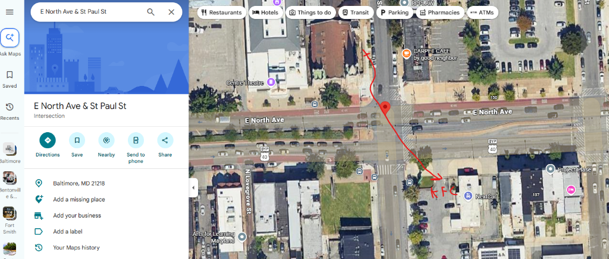

# Title Page

---

# AM I THE BAD GUY?

**From Hoodlum to Hopkins**

*by Michael Thompson*

---

> *"Intelligence and Guile."*
> - The Judge

---

# Chapter 1: Am I the Bad Guy?

---

I was a spectacular fuckup. The guy they point at and say don't be that motherfucker.

I don't lead with it. People tell me I lived an interesting life. What they mean is the file looks ugly and the rooms I walked through looked uglier. I wait. I let you meet the engineer first. Soften the blow. The man in front of you does not match the story, and I know it. Folks I've known for years won't know this until they read the book. Everybody wants to be the hero of their own shit. I'm uncomfortably aware I was the bad guy more than once.

Didn't start that way.

Golden boy for a long stretch. Teacher's pet. Top of the class. Smart-ass kid who actually was smart. Then it got away from me. That's how it happens - you're young, you're certain, nobody's snatched the wheel yet, and all of a sudden you're the cautionary tale. This book is how easy that is. And what it takes to grab life by the throat after it already put you on the ground.

I've been locked up. Freedom gone. Walked through all that shit. I've also sat in rooms most people will never see - critical infrastructure, national labs, federal work I still can't talk about. Director at Koch. CTO at one of the biggest automation houses on the planet. Principal engineer now. Same body. Different jacket.

South Baltimore kid in a North Baltimore school. Light-skinned problem in rooms that didn't want me. That wasn't theory. That was every day. Joined the military. They poisoned me. It's fine. What's a little poison between friends. I also - and I still laugh when I say it - accidentally became an international steroid kingpin. Whole East Coast, West Coast, South America pipeline. That was an adventure I did not put on the five-year plan.

Life leaves receipts. Scars across my head and face. Fake left hip. Legs marked up. Zipper down my gut where they cut me open and took the cancerous ball the Air Force helped grow. Functional safety engineer in me looks at that and says the probability of failure on demand for my own life was damn near certain.

I unfucked it anyway. Took the same shit that made me a fuckup and turned it into the thing that makes me dangerous in a useful way.

Japanese got a word for the break you don't hide. I studied the language in sixth grade and lived over there three years in the service, so yeah, I'm gonna say it: kintsugi. They fill the cracks with gold. They don't pretend the bowl never hit the floor. They make the drop the point.

That's the book. How not to walk into the stupid rooms in the first place. And if you're already in one - how to get out of that motherfucker and do it right.

The gold is the scar. This is me.

# Chapter 2: The Little Chickens and the Bleach

---

If you want to understand the machine, you have to look at the factory where it was built.

My factory was a row house on Williams Street, right in the Federal Hill neighborhood of Baltimore. My grandfather, Jim, a career railroad man who served in the Army Air Forces in WWII, bought the place with a GI loan for three thousand dollars. Jim was a physically large man. 6'2" with a thick frame. Even into his 80s he was hunting and pulling deer out of the woods in West Virginia. Jim would go to sleep at sundown or 7 o'clock. Whichever came first. Then he would be up the next morning at 4:30 a.m. He was a man of incredible routine. He walked or rode the train everywhere. I don't think he ever actually got a driver's license.

Today, Federal Hill is gentrified and expensive — a playground of high-end bistros and young professionals. Back then, it was just Baltimore — working-class, gritty, and smelling faintly of McCormick's spices drifting off the harbor. On humid days, the air was heavy with the sweet, sharp scent of cinnamon and nutmeg, a bizarre, pleasant mask over the city's harder realities.

But inside that house, the smell of McCormick's was always overpowered by the smell of bleach and the occasional ammonia — my grandmother's preferred cleaning products.

That was Pauline.

Pauline Sutherland was my maternal grandmother. She was a tiny, dark-skinned woman with high cheekbones and thick lips — my mother and I both look like her — and a presence that demanded absolute respect. She suffered no fools and took no bullshit. When you saw her ball up her fist, bite her tongue, and draw in a slow, silent breath, you knew what time it was. Someone was about to get an ass-whipping, and you just prayed it wasn't you. I was mostly good but caught the occasional ass-whipping. She had a little plastic chandelier in her living room. I found out the individual ornaments looked like little swords. I sat there throwing a pillow up in the air knocking them off. Needless to say, when she found me it wasn't an "oh that's so sweet," it was "I'm gonna beat your little ass!"

She kept that house incredibly clean. The kitchen had black and white linoleum tiles, polished until they shone like glass. In the winter, when the old radiators clanked and shivered, the natural gas stove was always left on, its pale blue flames hissing quietly to provide auxiliary heat. It was a house defined by its rules, its cleanliness, and my grandmother.

I spent a lot of time with Pauline because my own mother wasn't cut out for the job.

My mother was young, and she simply lacked those natural maternal instincts at that stage of life. Our relationship was complicated, mostly because it barely existed. She was a drinker. I rarely saw her; she was almost always in the bars. She would play the part of a loving mother to the outside world and talk fondly of me, but in reality, her actions never backed it up. She was a shadow in my life from childhood on. I never felt like she actually wanted to be there. When she looked at me, I didn't see warmth or connection. I saw a woman who viewed my existence as something she hadn't planned for.

Years later, my mother died of pancreatic cancer. It ate her away to absolutely nothing. Seeing her at the end of her life was a massive gut punch. After all, she was my mother. She gave me life. She sucked at parenting, but whatever. Seeing her in those final days gave me an unimaginable amount of pain. I got all the pain of watching her die, without any of the good memories to balance it out. How fucked up is that?

It was at her funeral that the stark reality of my bloodline was put into sharp focus. My aunt's boyfriend — a guy who knew both my mother and my father back in the day — was introducing me to some people at the service. He was talking about what I had accomplished and how smart I was. He paused, looked at me, and then told them point-blank that he had absolutely no idea where my intelligence came from, considering who my parents were. He wasn't trying to be cruel; he was just stating a mathematical fact. The inputs didn't match the outputs.

When you are a kid, realizing your mother doesn't want you can break you. It leaves a hollow space most people spend their entire lives trying to fill with alcohol, drugs, or toxic relationships. For me, that absence did something else. Because I didn't have a mother looking out for me at home, I sought out motherly love from the women I encountered in the world — mostly my teachers.

I figured it out early. If I was smart, if I performed, they would care about me.

I remember my first-grade teacher at Thomas Johnson School 84, Ms. Krinsky. She was so kind, and to me she looked like an absolute angel. I could read and write long before I ever stepped foot in a classroom, so when she had us write stories, I poured everything I had into them. She thought I was incredibly creative, and she gave me the warm praise I had never once heard inside the walls of my own home.

That was the spark. I felt that rush of validation. I realized that while my mother's affection was an empty drawer, I could get attention and care from the world with school. It drove an obsession with learning that never stopped. Decades later, when I was taking my own daughter to that exact same elementary school, I ran into Ms. Krinsky again. After all those years, she still remembered the stories I wrote in her first-grade class.

When I walked through the split entryway of the Williams Street house, past the hallway that led upstairs, I would head straight into the living room. That room was sacred. It was where the tree went at Christmas, and more importantly, it was where the encyclopedias sat. They were old World Book encyclopedias. Red. Gold lettering down the spines.

I didn't just look at the pictures. I sat on the floor, my back pressed against the cool wood of the baseboards, and read those encyclopedias cover to cover. I learned about functional systems, thermodynamics, ancient history, and anatomy. I built an entire worldview out of those bound pages while the gas stove hissed in the kitchen and the smell of bleach hung in the air.

But a young brain running that hot is fragile, and Baltimore in that era wasn't kind.

When I was five or six years old, I contracted tuberculosis.

TB isn't a modern child's disease. It's an old-world plague. It hollows you out, eats your lungs, and burns through your vitality. I was incredibly sick, fighting a fever that rose so high it warped my grip on reality, turning the familiar kitchen into a surreal landscape of fever dreams.

I remember sitting at the table in the kitchen, the faint smell of bleach mingling with the warm, salty broth Pauline had placed in front of me. I stared down into the bowl. The surface of the broth started to spin, the oily circles on the surface forming a tight, rapid vortex.

Suddenly, tiny little chickens — no bigger than pennies, but fully formed and chirping silently — began flying in a spiral, rising right out of the soup, swirling up into the air in front of my face. I watched them in a fever dream, completely entranced.

I looked up at my grandmother and told her exactly what I was seeing. "Pauline, look at the little chickens. They're flying out of the soup."

Pauline, the tough, no-bullshit woman who ruled the house with an iron fist and a bottle of bleach, broke down. She started crying. It is a terrifying thing for a child to see the strongest person in their world cry. She knew how sick I was. She knew the hallucination meant the fever was winning, that my brain was boiling, and that my body was on the verge of total failure.

I survived the TB, obviously. I did a stint in Mercy Hospital while they treated me. I remember having to take that blood-red disgusting medicine. I don't remember how long I was in there, but it felt like forever to a little boy. The fever eventually broke, the little chickens disappeared back into the broth, and the Williams Street house went back to its normal operations.

But I never forgot it. The mind can absorb encyclopedias and build whole worlds. It is still housed in a body that can fail.

I learned how to read from those books. I learned how to survive from Pauline. And I learned that, eventually, you have to look out for yourself, because the people who are supposed to protect you aren't always going to be there.

Pauline loved me. That love came out as discipline. In her house, you did what you were told, and you didn't step out of line. I rarely caught the wrong end of her balled-up fist because I was a good boy. I was smart enough to read the room.

But if you were on Pauline's good side, that same ferocity became a shield.

There was a substitute teacher at my school named Ms. Parsons. One day, for reasons I can barely remember now, she decided to be mean to me. She singled me out, treated me poorly, and made the mistake of letting me go home upset.

Pauline didn't write a strongly worded letter to the principal. She didn't call the school board to complain. That wasn't the Baltimore way.

Pauline went straight to the school, marched into the building, and confronted Ms. Parsons directly. She looked that substitute teacher in the eye and promised, with absolute, terrifying sincerity, to beat her to death.

It wasn't an idle threat. Pauline had the kind of presence that made you believe every word she said. She put the fear of God into that woman. From that day forward, Ms. Parsons never crossed me again. In fact, for years as I grew older, whenever I saw Ms. Parsons, she would smile nervously and say, "Say hi to your grandmother for me! Tell her how wonderful she is!"

Pauline taught me that the credible threat of violence could create boundaries when nobody else would.

# Chapter 3: Audrey Avenue

---

In my early years, I spent a lot of time being passed around. I lived with my grandparents on and off. My mother and father would get together and try to play house until that shit just fell apart — usually in a cataclysmic eruption of violence.

I would typically live with my father when my mother ran off. When I was 10 or 11, we moved to Audrey Ave.

Audrey Avenue was in Brooklyn, a neighborhood in South Baltimore. In the geography of the city, Brooklyn is where you go when you slide. It’s a purgatory of low-cost apartments, chemical tank farms, and a shittier class of people. When you end up in Brooklyn, you are there for one of two reasons: you are there to completely give up and let the city dissolve you, or you are there to get your shit together.

My dad was trying to get his shit together.

Just like my mother lacked maternal instincts, my dad was young and figuring out the father thing as we went. He did his best, but times were incredibly tough. He was working piecemeal work at Locke Insulators. Locke Insulators was probably one of the biggest polluters of the harbor. He used to tell me how they would just throw shit into the harbor. Everybody threw shit into the harbor; it’s almost like that’s what it’s for. It takes shit you no longer want or no longer want to be found. Now, that could be cracked insulators, chemical waste, guns, or bodies. Locke Insulators was adjacent to Cherry Hill. It was an even shittier place.

He would come home late at night, his steel-toed boots making a heavy, tired thud on the floor. He was a kind of skilled laborer, crafting the big industrial insulators you see on electrical distribution lines. My father was actually a fairly intelligent man. He knew those streets, but he took a couple of college classes. He never graduated, but I always remember him having a sharp mind for math. My father has a thick old-school Baltimore City accent. My wife, a native of Detroit, cannot understand him. She’s not sure it’s actually English.

One of my first lessons of this new area came one day when I was in the alley tossing a football in the air and catching it. Some older kids came by and just took my shit. They were teenagers, probably fourteen or fifteen. They didn’t give a fuck. Well, I ran and told my dad. We walked those motherfuckers down. We found them, and they were standing around.

He said, “Is this them?”

I said yes.

He said, “Take your shit back.”

I took my ball. He threatened them, told them if they touched me he was going to fucking kill them. Then he told me to punch the motherfucker in the face that took my ball. I paused, and he yelled at me to hit him.

It was like a crack I heard in my mind, like thunder. Hit him. Hit him again.

I just started punching the kid over and over. He started crying. I had blood on my fist from his nose and mouth. I cut my fist on his teeth. After that, I picked my ball back up off the ground, and we went home.

We lived in old, World War II-era housing — brick rowhouses that had been chopped up and converted into cheap, run-down apartments. Our place was small, cramped, and entirely stripped of anything resembling luxury. The walls were stark white, and they always smelled faintly of fresh, cheap paint. The landlords didn’t actually clean anything between tenants. Whenever a new person came along, they would just roll a fresh coat of cheap latex white paint directly over whatever grime, grease, or dead bugs were left behind by the last people. If you looked closely at the walls, you could see the raised outlines of dirt clods and hair permanently sealed under the gloss.

I didn’t even have a bed. I slept on a squeaking metal military cot in the corner of the small room, the canvas stretched tight and thin over the frame.

And there were roaches. There are always roaches when you live in places like that, but Audrey Avenue had them bad. They infested the hollow sheetrock walls. If you clicked the light switch on, the white walls would instantly come alive as they scattered. That memory branded itself into me. To this day, I haven’t seen a roach in years, but if my kids leave food, wrappers, or a dirty glass out on the counter, I will lose my temper and scream at them. My brain doesn’t see a harmless soda can. It sees the start of a brown, scratching army coming to reclaim my home. I’ve never been able to shake it.

The people on Audrey Avenue were a strange mix of the broken and the bizarre.

For the most part, they were nice, bound together by being poor in the same place. There was a lady who worked sanitation — we just called her the garbage lady — who used to comb through the trash on her routes in the wealthier zip codes. Whenever she found toys that people in better neighborhoods had thrown away, she would bring them home in her canvas bag and hand them out to us poor kids on the block. It was a beautiful, small act of kindness in a place that didn’t have much of it to spare.

There is another story from Brooklyn that brings tears to my eyes even to this day. I had a friend named John. He was a good kid, but his mother had six kids by six different dads, and she kept John out of school a lot to help with all those kids since none of their dads were in the picture. Because of that, he was pretty far behind.

John’s older brother was Tim. Tim was the fucking baddest dude. He did karate and was known as a tough motherfucker in the neighborhood. We all looked up to him. He was like sixteen or seventeen, and we were around eleven or twelve. He was a total ladies’ man. All the girls were chasing after him.

This fucking guy even knew how to use nunchucks. I was actually coming back with a wooden dowel to make my own set — my dad had taken me to the hardware store to get it — when we were hit by a drunk bitch on Hanover Street. We were at a red light on his motorcycle, and she plowed right through us. My shit was fucked up for weeks. It also ruptured my eardrum, and I had a massive scar on my leg from bouncing off her windshield and skidding across the ground. I only remember the sensation of flying through the air. Because of that accident, I never got to make those nunchucks.

Well, it turns out Tim was gay. It wasn’t a time or a place for that, especially not in a neighborhood like Brooklyn, and that pressure took its toll on him. One day, he blew his brains out with a shotgun in his room. John and I actually found him.

It’s another one of those things burned into my mind. It fucks me up even to this day. I get choked up even just thinking about it.

It fucked John up even worse. He wound up catching his apartment on fire. We left Brooklyn shortly after that.

And then there were Nancy and Sandy.

If Audrey Avenue was purgatory, Nancy and Sandy were the wardens. They were short and morbidly obese, with rolls upon rolls of fat that pushed up their cheeks and made their eyes look like permanent, squinty slits. They lived on the block, and they operated one of the most terrifying setups I have ever witnessed.

They literally kept slaves.

There were two other girls, sisters named Misty and Pam. Unlike Nancy and Sandy, Misty and Pam were rail-thin, looking like they survived on water and fear. I’m not sure how they wound up in this — whether they were runaways or abandoned relatives — but Nancy claimed ownership over Misty, and Sandy claimed ownership over Pam. It wasn’t a metaphor. These girls were forced to do all the housework, the cooking, the cleaning — everything. Whenever Nancy or Sandy would bellow their names from the porch, the two skinny sisters would come running like whipped dogs.

They weren’t chained. It was terror. Nancy and Sandy yelled at them constantly, called them every name in the book, and it wasn’t uncommon to see them casually pull the girls’ hair or slap them hard in the face in front of the entire neighborhood. The block watched, but no one intervened. In South Baltimore, you didn’t call the cops. You minded your own business.

I never understood why Misty and Pam didn’t just walk away. The cruelty was normalized, and it extended to the rest of their family too.

I remember one chilly afternoon, I was at Nancy’s house. Nancy’s husband ran a ghetto video store out of the house. He would get movies and tape them and lend them out. I was hanging out with Nancy’s son when Nancy and Sandy’s brother, J.R., decided Misty needed to be punished. I don’t recall exactly what she did — I think she might have left the gas stove on unattended while boiling water. J.R. was absolutely livid. He was a big, blocky dude, and he stood over her screaming while she cowered on the floor, weeping.

J.R. ordered her to bang her own head against the concrete floor.

She cried, shaking, but she did it. She hit her head on the ground.

“Not hard enough,” J.R. said, his voice flat, ordering her to do it again.

Misty slammed her own head into the floor with everything she had. It made a sickening, heavy, hollow thud that vibrated through the apartment. When she finally sat up, she looked completely dazed, blood trickling from her nose. That must have been enough, because he finally turned and left her alone.

I think Misty and Pam eventually escaped, but the memory of them — and that thud — stuck with me forever.

You had a woman digging toys out of the garbage to make poor kids smile, living right down the street from that. Same block.

It was a chaotic, bizarre environment, but my dad kept us moving forward. He used Brooklyn for what it was meant to be used for: a place to grind, get his shit together, and build a platform. Eventually his double shifts paid off. We climbed out of the slide, left Audrey Avenue behind, and moved up to Johnson Street.

But Brooklyn left its mark. Sometimes the world isn’t cleanly divided into good and evil. Sometimes it’s just a neighborhood where the garbage lady and the monsters share the same sidewalk. And your survival depends on knowing which one you are walking past.

# Chapter 4: Peeling Ears with the Paratrooper

---

By the time I was twelve, my environment shifted. I moved out of Pauline's house and went to live exclusively with my dad on Johnson Street.

Johnson Street was different. It was a place where boys had to figure out how to become men, usually through trial and error. My best friend, Mike, lived just a few blocks away on Light Street. Mike and I were inseparable.

But the real education didn't come from the streets. It came from Mike's living room.

Mike's dad, Mr. Hammonds, was an Army paratrooper who had served in the 1980s. He wasn't some towering action hero. He was short and stout, the kind of guy who smiled often — but it was a smile that thinly veiled the violence he was capable of. He was a genuinely nice guy, but he absolutely wasn't the "ask twice" kind of guy. Sometimes he didn't ask once. I remember one afternoon Mike and I were in his room fixing a bike tire, and Mike had his stereo playing too loud. Instead of yelling for us to turn it down, Mr. Hammonds walked down the hall and kicked a massive hole straight through Mike's bedroom door. Message received.

When he wasn't kicking in doors, he sat in a cracked vinyl recliner in their narrow rowhouse living room. Mike and I would sit on the carpet at his feet, twelve years old, looking up at him.

He didn't yell. He didn't boast. When he spoke of fighting, he talked like a man explaining a tool.

"You boys think fighting is about showing how tough you are," he said. "You think it's about standing square, trading punches like the guys on TV. That's playground bullshit. That's how you get your head cracked open."

"If another man puts his hands on you, he means to hurt you. You don't trade blows. You shut him down."

He looked at Mike, then pointed at me. "Come here, Michael."

I stood up and walked over to the recliner. He didn't stand. He didn't need to. He gripped my shoulder, thumb in behind the collarbone, and a sharp pain shot down my arm. My knees buckled.

"Let's say a guy gets close enough to grab your shirt," he said. I could smell the coffee on his breath. "You don't punch him in the ribs. You go for the soft tissue. You go for the ears."

He pinched the top of my left ear. He didn't crank it. He didn't have to.

He told us what an ear actually is — cartilage and skin, no real defense — and what happens if you rip it. He gave it a tiny tug. White flash of pain. Teeth chattering.

"When you peel a man's ear off," he said, "that will take the fight right out of them."

Mike, from the floor: "What if they pin your arms, Dad?"

"You still have your jaw. If a man has you wrapped up, his face is close. You bite the tip of his nose off. Doesn't matter how big he is. He's going to let go."

He sat with that a second.

"This isn't about being mean, and it isn't about showing off. If you have to fight, you end it. Peel the ear. Bite the nose. Survive." He taught us how to choke a man. He showed us how to break a collarbone. It was way better than a bullshit McDojo karate class.

I went back to my spot on the carpet, ear still burning, and I stored it.

To Mr. Hammonds the body had places you could break that ended the fight. I didn't need it explained twice.

Between Pauline's rage and the paratrooper's living room, I was getting an education I did not have a name for yet.

I was going to need it.

North Avenue was waiting.

# Chapter 5: The Neighborhood Boys

---

You don't survive a place like South Baltimore alone. You survive in packs.

Mine was a bunch of kids from the same rowhouses, same broke families, same streets. At the center of it was Mike.

Like his dad, the paratrooper, Mike was a bit of a brute — thick-necked, solid, and comfortable in the middle of a fight. We didn't become friends through polite introductions. We became friends through a 7th-grade schoolyard scuffle. Mike was supposed to be the tough guy on the playground, a reputation he guarded fiercely. I walked up to him during recess. I said, "You the new tough guy?" and before he could say anything I swept his legs out from under him and put him flat on his back in the dirt. We have been friends for almost 40 years, and he still remembers that as a cheap shot and gives me shit to this day.

Instead of getting up and trying to kill me, Mike lay there in the dust, looked up at me with a grin, and asked, "Do you fish?"

I said yes. From that moment on, we were inseparable. Same language: casual violence, loyalty, dark sarcastic humor. I have countless stories about Mike, mostly involving us trying to get out of catastrophic trouble we had put ourselves in.

Then there was Chris. He was the one who stood behind me on the stoop in Curtis Bay holding the bayonet during the Jerry Rose standoff. Chris was a fat slob and a bit of a pussy and spoiled. His mom was a nurse, and his stepdad was a massive stevedore down at the docks named Frank Door. A stevedore at the Baltimore docks is effectively an organized crime ring. They steal everything. If it comes and goes through the port of Baltimore, these guys get some.

Frank was a legend in our circle — a rotund man with a voice that rattled the windows. We called him "The Reverend Frank." Whenever he got drunk, which was practically every day, he would stand up in the middle of the living room on Light Street and start preaching fire-and-brimstone sermons about whatever. Don't get me wrong. Frank wasn't a fucking religious man. Not by any stretch. He'd just be sweating through his tank top, preaching to whoever was in the room about the fucking Blacks or whoever he felt wronged him that day. Frank was also the man who gave me my moniker. After the incident on North Avenue — where the locking mechanism on my Buck folding knife failed and I ended up burying the collapsed blade into my attacker's chest — Frank caught wind of the story. From that day forward, he refused to call me Michael.

To The Reverend Frank, I was simply "Blade." He would roar it out whenever I walked through the door: "Make way for the Blade! The boy who don't wait for the law!"

We spent a lot of time sitting on Light Street on Chris's front stoop, just watching what was going on. That stoop was our theater, and we saw some wild shit. Up the street there was a little corner store owned by an old man. Directly across from it was Wu's sub shop, where I would catch the bus for school. Across from the corner store was the Light House bar, and across from that was an old-man bar where you could get a coddie — a very Baltimore delicacy. A little codfish cake on a cracker with a pack of mustard. You got them for like 50 cents. The old-man bar had all the staples: the pickled onion, those little red hot sausages in the red water. Hmm hmm good. I forget the name of it. We saw countless fights between drunks pouring out of those bars. It was our version of Friday night fights.

From that stoop we would watch the Kirby house directly across from Chris's place. Catfish Kirby lived there. The house would get raided by the police and it would look like something straight out of a movie. The cops would rush in through the front door, and a split second later you'd see Catfish throw himself out the second-floor window trying to escape. He almost never got away. They always get you. That same house sat there for years with absolutely no electricity. It was a crackhouse, but I'd say it was a crackhouse for a slightly higher caliber of crackhead. It was South Baltimore after all, not some Westport shithole or Cherry Hill fucking bullshit. We were better than them.

We saw all types of drunks and weirdos come down Light Street. Once some random Black lady rolled up to the stoop and asked me if she could live with just one liver. She was obviously not right in the head. Some doctor probably told her something she couldn't understand, so she figured she would just ask a random white child for medical advice. I told her she only had one liver, but she did have two kidneys. I told her she could live with one kidney, though. She was really glad to hear this, thanked me, and continued on her way down the block. This was back in the 90s. A Black person walking around our neighborhood was just not something that happened. Now, the lady would likely get a pass as long as she didn't run into a drunk crazy coming out of one of the corner bars, or Fat Charlie.

Fat Charlie was a huge fat slob who bullied the younger kids. He was not fond of Black people, which kept a kind of tense, unspoken balance on that strip. Baltimore has been mostly Black for a long time. In many areas of the city I was the clear minority, and I was routinely targeted, cornered, and jumped purely because of my race. That was the geography. But at least in South Baltimore, because of guys like Fat Charlie and the local pack, there was a boundary.

I remember once I was getting off the 64 at the Light Street stop and some of the Cherry Hill boys were talking shit as I got off. They were losers from Southern High School, which was my zone school. I said, "Come on, get off the bus, bitch." It might've been more than "bitch," with a smirk, because I knew they wouldn't. I could see Fat Charlie standing on the corner. I've seen it happen before. I watched him throw, with pinpoint accuracy, a full bottle of beer across the street and brain this dude who I assumed wandered in from Cherry Hill. He threw that shit like Dan Marino and the guy dropped. He jumped back up as Charlie was running across the street. He tried to run, but his shit was all fucked up. He stumbled and tripped, but lucky for him, even concussed, he was faster than that fat fuck.

That boundary didn't mean you were safe from the local pack either. You didn't know if Fat Charlie was going to tackle you and pound your head in until you lost consciousness, or bite you — he was a biter — but he would guard against anybody coming in and starting shit. He was actually one of the first fights I got into after moving to South Baltimore. He was around seventeen or eighteen, and I was only eleven or twelve. He beat me up outside Wu's. The reason? I beat his high score on the Burger Time arcade game.

I fought him a second time at the basketball court outside my house. I had just gotten done whipping his cousin Bruno's ass. That little bitch scrambled off crying, yelling, "I'm going to get my cousin!" I just laughed. "Go get your fat fuck cousin!" By the time Fat Charlie lumbered onto the court, my adrenaline had dumped. I felt like a newborn kitten. Charlie threw me down on the concrete, punched me, and then bit me on my chest. Who the fuck bites a little kid on the chest? A fucking psycho, that's who.

We had Eddie, a good guy whose family was even poorer than ours, but they did hustle. His dad ran a tiny cramped corner store that sold stale bread, single cigarettes, and cheap soda to keep the lights on. We were at Eddie's house once and Chris's fat ass flopped on the sofa. That shit collapsed and red stuff started oozing out from underneath it. Artie was like, "Hey Ed, I think Chris's fat ass killed your dog." We all stared thinking Chris flattened Eddie's dog. As it turned out, they were using a tomato sauce can as a sofa leg. Eddie also had some kind of bone deformity that made bones grow out of his joints at weird angles.

We had Artie Buckalew. Artie was probably the poorest kid in the group, wearing the same faded, oil-stained t-shirt for days, but you wouldn't know it from hanging out with him. Hilarious, loyal, good-hearted, with a thick speech impediment — a mushy, rapid-fire South Baltimore drawl. He had a heated rivalry with Mike for a reason no one could remember. It might have been Mike finding an old discarded guitar and smashing it over his head.

Then there was Jesse Wright. Jesse lived on the street directly behind my house, and he was a complete dirtball. Greasy, grimy, always filthy. Kind of a pussy too. He lived under the protection of his two older brothers. His one older brother used to say he had a dream where a plane load of Mexicans crashed into Cherry Hill. He would say it was the best dream he ever had. I'm not sure where his hatred for Mexicans came from. There weren't that many back then in Baltimore.

And then there was Spunky.

Spunky's real name was Patrick. His parents called him Spunky because he was born really premature. They said he was so small they brought him home in a shoebox, and though the doctors thought he was going to die, he survived. One of them remarked he had a lot of spunk. Thus, Spunky. Again, probably a result of all the chemicals in the area. He was intellectually disabled — he was retarded — but you never, under any circumstances, brought that up around him. He was a wrecking ball. Shorter side, but he had that strength.

One day we were hanging out on the front stoop of Spunk's house. The younger McFarland boy, his neighbor, came over and started shit with him. Spunk didn't really have any conflict resolution skills outside of punching the other side in the mouth. So he hauled off and smashed the younger McFarland, folding him like a fourth-grade love letter.

When the boy got his shit together, he went in the house and got his older brother. Now, this might be uncommon now, but I still teach my kids: if someone fucks with your brother — I don't care who it is — you better beat that ass. This is our culture. Unfortunately the older McFarland didn't have a lot to give, but he knew his dad would beat his ass worse if he didn't try.

He came out running and threw a punch that hit Spunk but hardly registered. That was the trigger. Spunk grabbed him and started wailing. The commotion brought the McFarland father running out of the house. The dad grabbed Spunk. Spunk turned and landed a wild haymaker right to his jaw.

Here is something I learned: always look at the back. If the opposition has a wide, strong back, their punch is going to do damage. Spunk was a fat fuck, but he had a strong back. Strong back, weak mind. When Spunk connected, bodies hit the floor. The father dropped. In the course of minutes, Spunk put down the whole bloodline.

Not everyone in the pack was defined by brute force. Some were defined by what they failed to become.

Ed, aka Big Ed, who we called "Big Head" because of his massive skull, went to high school with me at Baltimore City College. Ed probably would've been a school shooter, but he was too much of a pussy. He constantly tried to craft an image as a badass, but we all knew him. He was a bitch. Heavy-set, probably around 5'10", and he folded the second physical pressure turned on.

Ed left his own brother to get beat up at the '84 Rec center, and I had to go get him. Ed abandoned me on Greenmount Avenue when I had to stab a dude in the neck with a pen. Ed wouldn't even get off the bus when three guys wanted to fight. My boy Rob Croft had to have my back instead.

He lost all of his teeth one summer when we were playing wall ball at the abandoned warehouse down the street. Spunky had this big-ass wooden bat. He swung, and the bat slipped out of his hands. It flew over and hit Ed right in the mouth and destroyed his teeth. His family didn't have insurance, so after a trip to the emergency room he just carried on with a mouth full of smashed teeth. I don't think he ever got them fixed. Getting hit in the face with a bat made Ed think he was a badass. He still couldn't fight, and he didn't have the heart for it.

There was one area where Ed was fearless: stealing.

Ed was a prolific thief. When Eddie Aaron got his driver's license, we would get in his beat-up car and go to Marley Station mall, where Ed would steal everything not nailed down. Coward in a fight, fearless thief. This motherfucker once stole an entire hockey stick by putting it down his shirt and threading it all the way down through his pant leg, then walked out of the mall stiff-legged like he had a crippling disorder.

Ed had a staggering mathematical mind. Exceptionally smart. And almost no emotional intelligence or drive. He was a weird fuck.

Today I work the jobs I work. Big Ed became a lunch-meat slicer at a couple of grocery stores in Baltimore. Tremendous wasted potential. A mind like that measuring ounces of bologna.

Looking back, that crew was killers, dreamers, hustlers, and casualties. We learned how to fight from a paratrooper, got our nicknames from a drunken stevedore, and watched a genius slice lunch meat because he couldn't get past his own fear.

They were my first real team. They taught me who I wanted to be, and who I refused to become.

# Chapter 6: The City That Bleeds

---

The irony of the Baltimore City Public School system is that trying to get a better education usually meant increasing your chances of getting killed on the way to class.

My father meant well. When it came time for high school, he knew that Southern High School — my designated zoned school — was an absolute shithole. It was a holding pen for the neighborhood's future inmates. So he pushed for me to go somewhere better.

I got accepted into Baltimore City College High School.

We all loved "City." We were proud of it. Founded in 1839, it's the third-oldest public high school in the United States. It sits on a hill at 33rd Street and The Alameda, housed in a massive Gothic-style stone building. They literally call it the Castle on the Hill. City was a magnet school, designed to bring together the top ten percent of students from all of Baltimore City Schools. You didn't just win a lottery to get in there. You had to be smart. The people there were good people, for the most part, especially after freshman year, when the kids who couldn't hang got purged off the roster.

Inside the Castle, we had teachers who actually cared if we survived. I vividly remember Ms. Stukes Maurice. She sat us down one day and explained code switching. She told us, point-blank, that if we wanted to make it in the professional world, we needed to know how to talk like white people. We needed to know how to turn the street off and turn the polish on. She was preparing us for a world that most kids in our neighborhoods would never see. Ms. Stukes Maurice was a Black Panther, and she was very proud of it. She made sure to tell us every chance she got. She was a nice lady. I always kind of felt like she didn't like me because I was white, but she was all right.

But to get to that world, to reach the Castle on the Hill, I had to survive the commute.

In the late 1980s, Mayor Kurt Schmoke — who happened to be a City College alumnus himself — launched a massive literacy campaign with a catchy slogan: The City That Reads. They painted it on benches all over town. But this was Baltimore. The murder rate was skyrocketing, and the streets were darker than a PR campaign. It didn't take long for the locals to take out their spray cans and correct the benches. Everywhere you looked, the slogan was crossed out and rewritten.

It became The City That Bleeds.

I was a fresh fourteen-year-old kid, and to get to my prestigious high school I had to catch two different city buses straight through the worst, most violent neighborhoods in a bleeding city. The first bus I caught every morning was right in front of Wu's convenience store. Wu was a Korean lady who owned the sub shop on the corner of the 1800 block of Light Street. She knew Gabby's grandmother, who owned the shop over in Westport. They didn't compete. They actually all knew each other. The local Korean business owners participated in a traditional money-pooling system — like a kye — where every month twenty of them would throw in thousands of dollars, and they'd take turns collecting the pot to do renovations or handle big expenses. It was a fascinating way to do business.

Out on the street, business was different.

There is a distinct, unforgettable stink to a Baltimore City bus. A humid mixture of exhaust, stale sweat, cheap malt liquor, and desperation. Those buses were rolling thunderdomes. Packed metal tubes.

One of our regular sights on the route was a schizophrenic guy we called the Devil Dog from Hell. He would stand at the bus stop right in front of Wu's, violently beating a payphone with a black plastic trash bag, screaming about the devil dogs from hell and how the phone company was putting things into his head. He was a wild one, but honestly he was the least of our problems. The crazy ones were predictable. It was the sane ones you had to worry about.

On those buses, fights broke out over nothing. Eye contact held a second too long. A scuffed sneaker. A perceived slight. That was the baseline. You either looked like you might do something, or you became prey.

A kid named Jake caught on to it. Jake was one of the guys at school, and one day at lunch he was looking at me.

"I act crazy so people don't mess with me," Jake said, shaking his head. "But I'm really actually normal. I feel like you are the other way around. I feel like you are acting normal."

He was right. Inside the Castle on the Hill, I was learning to code switch. I was learning to turn on the polish. Out on those two buses, the normal kid was dying. Something else was taking the wheel.

# Chapter 7: Mechanical Failures

---

I was fourteen the first time I had to stab someone.

It's a fucking shame that a kid growing up in America has to say that sentence out loud. People hear it and assume I'm bragging or exaggerating. I'm not. I was a tall, lanky kid, still soft around the edges, who hadn't fully grown into his bones yet. Baltimore didn't care what I looked like. Baltimore only cared that I was standing in the wrong place.

I had just gotten the hang of the buses to and from school. From my house it was the 64 to the 3, or the 64 to the 36. I preferred the 64 to the 3. It didn't take me through any nicer an area, but if I was coming home I could take the 3 to the Inner Harbor, and in a worst-case scenario I could always walk home. It's not like the ride was any nicer. It was still a shithole regardless of the bus line.

Sometimes you just had to take what you get. One day, as is often the case in Baltimore, the temperature hit 90 early enough in the morning that they had to send us home. Baltimore City schools didn't have air conditioning. All that money in that school system and no AC. Where did it go? I think we all know.

So there I was, catching the 36 at school to get to the 64. As luck would have it, the 36 broke down on North Ave. The driver kicked everyone off. No explanations. No backup plan. Just "everybody off." That was MTA back then. It still is in some places.

It was only a few more blocks to the next connecting stop, so me and Big Ed decided to walk it.

Bad idea. That walk took us down North Avenue, right across the street from Greenmount Cemetery. If you know Baltimore, you know Greenmount. High stone walls, miles of graves, dead leaves, and silence. A city of the dead sitting in the middle of the city of the living, or what passes for living. We were on the opposite side of the street, just trying to get past it.

We were halfway down the block when it happened. I didn't hear footsteps. I didn't hear yelling. I just felt my body jerk violently sideways. A grown man came flying in from behind and clotheslined me so hard my feet left the ground. I hit the pavement hard. Before I could get up, they grabbed me and dragged me into a side street.

Ed didn't wait. He ran. I can't blame him. He was fourteen too. But that moment burned something into me: when things go bad, you might be completely alone.

Two grown men stood over me, screaming. "Why you do that, yo? Why you do that, yo?" I hadn't said a word. I hadn't even looked at them. They kept repeating it like it gave them a reason to beat the hell out of a white kid. They punched me, kicked me into the brick wall, cracked my ribs.

My confusion lasted maybe three seconds. Then I thought they were going to beat me to death. I reached into my pocket. All I had was a cheap pen. I wasn't carrying a knife yet. I was still innocent enough to think I didn't need one.

One of them grabbed my collar and yanked me up to his face.

No thought. No hesitation. Just a wild, desperate swing. The pen went into his neck. To this day I can't remember the guy's face. People have told me that's the mind protecting a fourteen-year-old boy. I do remember the feeling of it sticking. Even now it brings a smile to my face. I hope that fucking loser lived and changed his ways. I believe in second chances.

His friend saw it and took off running like he'd been shot.

I bolted. Full sprint. No looking back. I walked the rest of the way home, a long way, thinking one stupid thing the whole time: I hope I don't catch hell from my dad for tearing my dorky white-and-green striped shirt.

I don't know what happened to the guy I stabbed. All I know is he didn't chase me. That moment changed something in me. Not in a dramatic "this is the day I became a man" way. More like a quiet switch flipping. At fourteen I learned: grown men will hurt a kid, the world will not pause to help you, and your friends might run. Your only chance is whatever you can do in the next quarter-second.

People hear stories like this and think trauma. Pain. Psychological scars. For me it wasn't a wound. It was information. The world showed me how it worked. I adjusted.

Sometime later that same year I was catching the bus from City College to the 64 switch at North Avenue. It was me, Big Ed — who had fled during the pen stabbing — and a kid named Rob Croft.

Rob was a ginger with strawberry-blonde hair, and he had the most hollow, dead eyes I had ever seen on a kid. He was white trash like me, but he was broken on a level I couldn't even comprehend. The rumor was that he was a victim of the local "pay for play" pedophiles in his neighborhood. Whatever happened to him, it left him profoundly damaged. But we were school friends, and I liked talking to him.

We were on the bus when this skinny little skater punk and his friends started running their mouths. He was with a fat kid who looked like the Hawaiian Punch mascot, a tall goofy kid in a trench coat, and a pretty girl named Sasha. They were all white kids. The skater punk had a piece of paper with a printed-out joke on it — something stupid like, "Speak slowly, I'm blonde."

I didn't get the joke. I told him as much.

"Well, you're fucking retarded," he said.

I was instantly furious. I hadn't even engaged this kid, and he was taking shots. The argument escalated for the entire fifteen-minute ride to North Avenue. I finally told him to get off the bus at the next stop so I could beat his ass.

I turned to Big Ed. "There's three of them. You got my back?"

"No," Ed said. "I don't want to get involved."

"Can you at least hold my books? If they beat my ass and throw my books down the sewer, my dad is going to kill me."

"I don't want to be involved," Ed repeated.

That was Big Ed. Always reliable when the temperature rose.

Rob Croft, sitting there in a cheap grey jacket with black sleeves, looked at me. His voice was ice-cold. "I got your back. Don't worry about it."

We got off the bus at North Avenue. The skater punk, Hawaiian Punch, Trench Coat, and Sasha followed us out.

The bus driver didn't pull away. He put the bus in park, leaned out the window, and settled in to watch the show.

The skater punk started yapping again. Before I could even swing, Rob Croft stepped forward. He didn't yell. He didn't posture. He just looked at Hawaiian Punch and Trench Coat with those dead eyes and pointed at Sasha.

"If one of you motherfuckers jump in," Rob said, flat and calm, "when we're done beating your ass, I'm gonna rape your girlfriend right here."

I was stunned. Who the fuck says that? Rob did, because he was dead inside and broken. It was his way of standing up for his friend.

The two friends froze. They were expecting a standard teenage fistfight. They were not expecting that. They backed off. It was just me and the skater punk.

The kid panicked and dove at me, trying to grab my balls for a takedown. In South Baltimore we are taught early to protect against cheap shots. I stuffed it, dropped him to the pavement, and beat the hell out of him. Boom, boom, boom. He was crying like a little bitch. Not an ounce of self-respect. I didn't stab him. I just gave him an ass-whipping. They don't know how lucky they were that Rob was there. If I was alone and they jumped me, it would have gone differently. At that point in my life I had already been jumped once with a pen in my pocket. The thought crossed my mind. The fight going the way it did saved their lives.

And the entire time, the adult bus driver was hanging out of his window, cheering. "You go, champ! You go, champ!"

The kid eventually scrambled up, wiped the blood off his face, and wandered off with his friends. I never saw any of them again. A lot of kids disappeared during the great filter of freshman year at City. Rob Croft was probably one of them. Another tragic loss to the streets of Baltimore. I don't know what happened to him, but if he didn't kill himself, he almost certainly ended up in prison. There was no coming back from where he was.

The next day, when I got on the bus, that same driver pointed to the seat right behind him.

"I got a seat for you, Champ," he said. He saved that seat for me and called me Champ for the rest of the year.

That was North Avenue. A year later, on that same road, it got tested again.

The corner of St. Paul and North Avenue was the kind of place where something bad could find you even if you weren't looking for it. November, creeping up on Thanksgiving. Flat, cloudy gray sky. North Avenue a busy four-lane divided street. Tall brick and concrete on either side like a canyon, diesel and gas from the MTA buses, horns, the greasy smell of lake trout and chicken boxes drifting down the block. Busted pavement and a big black cast-iron fence in front of the old cathedral. A place that looked holy from a distance and meant nothing on the ground. God didn't hang around there. The crackheads did. The stickup crews did. Kids like me did, because that was where the bus stopped.

I was fifteen. I saw them coming from a mile away. My friend Matt and I were waiting for the next bus when a group of five guys walked by and eyed us. They saw Matt's Starter jacket and went around the corner to plan their move. When they came back they walked straight up to him.

"I like your jacket, yo."

Matt said, "I like it too."

"Give it to me," one of them said, and punched him.

Matt was a soccer player, not a fighter. He ran his ass off. I probably could have run too.

Marcello came at me first. Five of them circled in, my back pinned against the cast-iron fence. I remember his face like a sketch: hard eyes, lip curled. "White motherfucker." He was talking shit, trying to get in my head. I was already past listening.

I kicked him in the face. Split his lip. For one second the circle hesitated. Marcello wiped his mouth and grinned.

"A karate boy. We like karate boys around here."

Before the words finished, another one came in from behind and smashed me over the head with a board. The shock split my scalp open. Warm blood ran instantly. The world rang like metal. I staggered, and that was the opening Jesse Davis needed (a different Jesse, not my friend Jesse Wright). He rushed me, grabbing, pulling, trying to drag me to the ground. He was heavier, older. If he got me down they would stomp me.

My left hand was already in my pocket, on my old folding Buck knife. As Jesse tried to drag me down I turned sideways, flicked the blade open, and swung. It wasn't flashy. It was a left hook to the body, with a knife. I didn't show it to him. I drove it into his chest.

I felt the blade go through the jacket. Then I felt it hit bone. A sudden snap ran through my hand. The force was too much for the pin. The lock failed. The blade collapsed back against the handle and cut me. It didn't take my fingers off, but it was close.

I snapped my arm back to go again, but I didn't have to. I heard the air leave his chest like someone letting the air out of a tire. The fight left him. He melted off me. Eyes wide, confused, still in the middle of attacking me.

The circle froze. That shock was the only gap I was going to get. I ran straight through it and sprinted into North Avenue traffic without looking. Tires shrieked. Horns blasted. Cars swerved. I didn't care. I hit the far sidewalk, grabbed the heavy door, and burst into the Kentucky Fried Chicken.

I had maybe ten seconds. I ran to the counter and yelled at the workers behind the bulletproof plexiglass to call 911. They just stared and laughed like it was a joke.

Then the heavy glass doors blew open. The crew flooded in behind me. They dragged Jesse inside and laid him across a booth. His chest barely moved. The laughter behind the glass stopped. This wasn't a joke anymore.

Suddenly it wasn't just the crew. Grown adults who had nothing to do with the fight started shouting from the corners. "Kill that white motherfucker!"

I was on my own again. Me against an entire neighborhood.

I looked down at my hand. The knife was useless. Lock sheared. Blade loose. They didn't know that. From the outside it still looked like a knife in a kid's hand who had just used it.

The circle started forming again, tighter this time, trying to get behind me. I scrambled for anything I could throw: salt shakers, pepper shakers, plastic trays.

Then someone swung from my blind spot and smashed a forty-ounce bottle over my head. The world went white. My forehead split open. Blood poured into my eye. I tasted iron. I felt myself slipping.

I fought through a side gap and ran for the hallway to the bathroom. Narrow space. One or two at a time. I hit them with the door, pushed inside, and slammed the lock. The broken Buck knife went into the toilet.

I looked in the mirror. Short spiked hair matted with blood. One eye swollen shut. I looked half dead. I laughed. Not because it was funny. Because for a second I was still standing.

Then the knock came. Baltimore Police Department. At first I didn't believe them. I dropped to the floor, looked through the vent, and saw the blue pants. Real uniforms. I opened the door.

They kicked the shit out of me immediately. I don't blame them. All they knew was that a crazy white kid had stabbed someone and was locked in a bathroom in a packed KFC on North Avenue. I kept saying, "They jumped me. They jumped me."

Eventually the story sorted itself out. One cop stood in the hallway blocking Jesse's aunt from reaching me. She was screaming that I killed her boy, that she wanted me dead. The officer, a big blond blocky dude, didn't flinch.

"Bitch, if you come down this hall I will blow your fucking brains out. This place is a war zone. This is how you act in war."

Paramedics finally got inside. They wrapped my head in so much gauze I looked like a mummy. When they rolled me out the crowd still wanted blood. I gave them the finger. Got one in.

In the ambulance the escorting cop told me not to worry. I did what I had to do. Then he said something no cop would ever say on record: "When you stab one of those animals, always yank the knife up to finish the job."

They took Jesse and me to different hospitals on opposite sides of the city. The doctor dug glass out of my scalp, poked into the wound to make sure nothing was lodged, then stitched me closed. I felt every pull.

A few days later I went back to school. Instant legend. My father told me flat out they would kill me if they saw me again. He handed me a .38 and said, "If they come at you, you better start shooting." Even the principal looked at me like she knew I was armed. To this day I appreciate Dr. Harris. She could have caused me a lot of trouble, but I think she understood I was just trying to go to school.

There were certain realities when you were just trying to get from A to B in Baltimore.

And I knew something else, too. I never carried a folding knife again. A lock is a promise, and promises break. From that day on I only carried a fixed blade. One piece of steel. No moving parts to fail you when it counted.

I was still learning.

# Chapter 8: The Bayonet and the Rules of Engagement

---

There are shitholes, and then there is Curtis Bay.

It sits on the southern tip of the city, smelling like chemical runoff and industrial exhaust. I was there hanging out at my friend Chris's grandmother's house. I had brought something with me that day. A piece of history. My grandfather, Charlie Thompson, was a Marine in World War II. He had given me his old service bayonet. Heavy steel. Bakelite handle. A weapon designed for the Pacific theater, now sitting on a stoop in South Baltimore because Chris's grandmother's husband liked war memorabilia. Chris's grandfather was a good man. He died of cancer. Everyone in Curtis Bay dies of cancer.

We were sitting out front when the trouble started. It was stupid. Trouble in Baltimore usually is.

Some neighborhood girls were walking by, messing with Chris. They were flirting in that aggressive way people do around there, throwing shaving cream at him. Chris wiped it off his face and flicked it back. It was playing. It was nothing.

Except the foam didn't hit the girls. It landed on Jerry Rose.

Jerry was a local guy who, in typical Baltimore fashion, had an ego made of glass. He didn't see the joke. He became inconsolable. He started screaming, posturing, demanding respect. He wanted to fight Chris.

Chris was a good friend, but he wasn't built for that. I knew it, and he knew it. I stepped in.

"Come on," Jerry said, turning his focus to me. "I'll knock you out."

I didn't respond.

Then he added the line that somehow hit different:

"I'll knock you out, big boy."

For some reason that one phrase struck a nerve I still can't explain. Something in me flipped.

"Let's go then."

I didn't wait. I walked him down. He started backpedaling across the street, realizing too late that I wasn't playing. I caught him in the middle of Church Street.

I threw a low kick into his calf. I had success doing this sparring with my friends, so I kept it in my bag. Being my friend wasn't always easy. I used to practice on them and would routinely knock them down with that same sweep. We played rough as hell.

The moment his leg buckled I followed with a straight cross that dropped him to the asphalt.

He wasn't out, but he was done. He scrambled up, humiliated, and ran down the alley.

"I'll be back, motherfucker!"

I walked back to the stoop and sat down. Me and Chris laughed about it. We thought it was over.

Ten minutes later, the alley filled up.

Chris nudged me. "I bet Jerry is in that crowd."

He was right. A mob was moving toward us, and right in the front was Jerry's little muppet ass, bouncing around, pointing, yelling, "I told you I'd be back, bitch!"

One on one is a fight. One on ten is a hospitalization.

I jumped off the stoop. I grabbed the bayonet.

Just like on North Avenue, I had choices. I could've run. I was fast and in great shape from wrestling. No one would've blamed me. I could've gone inside. I didn't. I wasn't brave. I was fucking stupid. That theme would keep showing up.

I pulled it from its metal sheath. That satisfying rubbing sound of steel on steel. I walked out to the center of the street to meet the line.

"If it's going to be all of you against me," I said, "it's going to be me and this against all of you."

The crowd hesitated. They wanted to stomp a kid, not get cut by a Marine's bayonet.

Chris, from the back, matter-of-fact, almost melancholy, like he already knew the outcome and felt a little bad for them: "He will stab you. He has stabbed people before."

Best reference letter I ever got. The mob got quiet. No one wants to get stabbed.

One of the guys stepped forward, hands up. "It don't gotta be like that, man. Jerry just wants another go."

I looked at Jerry. I looked at the crowd.

Truth is, I was way more balls than brains back then. Far more likely they jump me the second the bayonet is out of reach. But beating Jerry's ass earlier had felt so good. I went ahead with it anyway.

"Fine," I said.

I turned to Chris and handed him the bayonet. "Hold this. If they jump me, just bring it to me. I'll handle the rest." Chris wasn't built for that life. I was still pretty sure he'd bring it, if only because he knew what I'd do if he didn't.

I met Jerry on the street line. Here we go again.

Same combination. The leg kick landed hard. I missed the cross, but the damage was done. Jerry stumbled back limping and looking panicked.

"Hey!" he yelled. "No kicking!"

I actually laughed. "You asked for this. There ain't no rules."

"No kicking," he pleaded. The crowd was silent. They were watching their champion try to negotiate the terms of his own ass-kicking.

"The next time I touch you," I said, "it's going to be worse."

Jerry started rethinking his life choices. That second kick was setting in. He lost his nerve. He looked back at his friends, hoping they would save him. They just told him to get back in there. They wanted blood, even if it was his.

He came back out for one last try. Slow. Hesitant.

I didn't even punch him. I just bitch-slapped the shit out of him. The sound cracked through the street. A punch is violence. A slap is disrespect.

Jerry wilted. He turned around, walked back into the crowd, and disappeared down the alley.

His friends lingered for a second. Some of them actually came over and nodded, saying we were cool. They respected the outcome. I nodded back, but I walked straight to Chris and took the bayonet back. I stayed on edge until we were back inside the house with the door locked.

I looked at the bayonet. It had done its job without drawing a drop of blood.

Violence implied can be as effective as violence applied. They just need to know you're willing to take it to the end. I'll never forget how the temperature changed when Chris said I had stabbed people before. I didn't say it. I didn't brag. He said it calm and matter-of-fact, and the mob went quiet.

# Chapter 9: The Truck

---

I personally was never a thief. I have a disdain for thievery. I think it's the absolute lowest form of shit you can be. But not everyone in my crew shared that sentiment.

Around that time, Eddie Aaron got his driver's license and picked up a cheap old truck — maybe a Toyota Tacoma or something like that. Beat-up, but it meant freedom. We would put our pennies together, pile in, and drive out to a place in Glen Burnie called Doc Ribs. Tragic story. The man who owned it made incredible food, but he got robbed so many times — not by us, for the record — that it eventually drove him out of business. In Baltimore they say you only need a lid on the basket if you catch one crab. Drop a second crab in and you don't need the lid. Whenever one tries to climb out, the others pull him back down. Doc Ribs couldn't get out.

Eddie would usually bring Artie Buckalew and Big Head — Big Ed — along. Big Head was a huge pussy who betrayed me every chance he got. For whatever reason there must be some overlap between being a coward and being a thief, because Big Head was a master at it. He could steal the toast from underneath the butter before it even melted.

Eddie would drive us out to Marley Station Mall, and Big Head would basically go shopping. Sam Goody for CDs. Trench coat, load up. Sports Authority, Dick's, anything he could get his hands on.

Artie was right there with him. Another one who could lift just about anything. And Eddie was a genius at getting CDs out of those rigid plastic security cases. Wasted mind. Wasted potential. Brilliant at that. If he slipped and the door alarms went off, Eddie would just stop, put his hands up with a confused look like, "What's going on?" The mall cops would usually wave him through. None of them ever got busted. None of them ever paid the consequences.

Just the daily crime wave of these assholes riding around in a cheap truck, stealing everything they could get their hands on.

# Chapter 10: The Stet Docket

---

The years rolled on, and the walls of Baltimore started to feel closer together. I needed an exit.

My buddy from City, Kareem, had a plan. "Let's go be Marines," he said.

I figured, all right, whatever. It made sense. The Marines were tough, they were respected, and more importantly they were away from fucking Baltimore. I wanted money for school. I wanted to see the world. Specifically, I wanted to go to Japan. I had been studying Japanese since the sixth grade — a little piece of discipline and culture that just didn't fit with the chaos around me.

We went to the enlistment office, ready to sign our lives away to the Corps. But the Marine recruiter was out to lunch or doing PT, or whatever Marines do. The office was empty. Just as we turned to leave, Tech Sergeant Cartwright walked out of the Air Force office next door. He looked at us and smiled.

"What are you boys here for?"

"We want to be Marines."

Cartwright shook his head like a disappointed father. "Don't do that to yourself, son. You join the Air Force, I will fly you around the world. I will give you access to fine wine and fine women. You'll sleep in a bed, not in a foxhole."

I didn't need to hear about the wine. I just needed to hear "around the world." Anything that got me out of Baltimore was the right path. I signed the papers for the Delayed Enlistment Program right then and there. I was seventeen. I signed up before my birthday. Ship date: January 3, 1995. I had months to kill. I just had to stay out of trouble.

That's not always as easy as it sounds.

One night I was sitting at home. I was sick, feeling under the weather, just trying to keep a low profile, when the phone rang. Charlie O'Heron — Big Ed's younger brother. He was up the street at the School 84 Rec Center, and he was panicked. Some guys were threatening to kill him.

"Where's Ed? Where's your big brother?"

"I'm on my own," Charlie said. "Ed told me to figure it out."

That fucking burned me up. You don't leave your brother on his own. That's a direct violation of the code.

"Call your brother," I said. "This is big brother shit." But if Ed wasn't going to step up, I had to.

"I'll be right there."

I called Mike Hammonds and told him the situation. Mike didn't ask how many guys there were, or if they had guns. He just asked, "Are we going to do this?" He said he'd be right there. Minutes later, he rolled up.

Charlie told us it was a whole group of them, so I grabbed a small sword and tucked it inside my jacket, under my arm. People see a wide blade and they freeze. We walked up to the Rec Center.

Mike and I walked in. Charlie was already there. He pointed out the issue. He'd been playing ball, things got rough, and he tried to walk away. Someone threw a basketball at his face. Charlie just caught it and set it down. Small act of defiance. It enraged the guy. They told Charlie that the second he stepped outside, they were going to beat him to death.

There was no fighting inside the 84 Rec. You got caught fighting in there, you got kicked out permanently. Then where would you go? So everybody kind of respected it. Holy ground.

"Come on," I said. "Let's go."

We walked out the doors. Mike first, Charlie next, me a couple of feet behind. As soon as we crossed the threshold, it was pandemonium. Seconds. The crowd swarmed. Charlie on the ground, getting pummeled. Mike throwing bombs, fighting off two or three guys at once.

I moved toward Charlie. I figured Hammonds had his shit under control. Two guys stomping Charlie. I rushed them and knocked them off. One of them ran up a little ramp by the Rec — a small retaining wall — and jumped off it like he thought he was Bruce Lee.

I swung with my left, a hard overhand, and completely connected. I punched that motherfucker right in his forearm and heard a loud snap. That was Mike Lowry. Broke his arm. He was on the ground crying like a bitch.

That's when I realized things were getting serious. I pulled out the sword.

Everybody started yelling, "He's got a sword! He's got a knife!"

I looked over at Mike. He had some guy locked up in a WWF DDT-style hold, ready to smash the guy's head into the concrete. Mike looked over at me, calm, honestly looking like he was having a good time.

"Come over here and break this motherfucker's ribs," Mike said.

I walked over. The sea of people parted. I didn't use the blade. I kicked that guy in the ass.

"Come on, we gotta go," I said. "Ain't got time for this shit."

We walked away. No one followed.

I went back to my house. The adrenaline faded and I was just sick again. I sat down.

Then came a knock. Not a normal knock. It rattled the wooden frame.

"POLICE! OPEN THE GODDAMN DOOR!"

I bolted up. I looked at my younger sister. She was already headed for the door.

"Don't let 'em in!"

She was young, and the badge had a presence over her. She didn't know what to do. She opened the door.

In came two Baltimore Police officers from the Southern District. They didn't care about warrants or civil rights. They were hyped up on their own shit.

"Where's the fucking sword?"

So much for snitches get stitches. Those little bitches ratted me out.

"What sword? I don't have a sword. I don't even own a sword."

"If you're gonna be a little prick, then you're gonna go to fucking Southern District."

They cuffed me and hauled me down to Southern District lockup. I was hanging out in the cell with all kinds of wonderful and interesting people. The Black guy in the cell next to me leaned over.

"What you in here for, big youngin?"

"I don't know, they picked me up for a fight. But I was just sitting in my house."

He looked at me. "The violent crime task force picked me up."

"Oh man, all right, cool. Good to know." He was pretty chill.

I sat there and waited. And waited. And waited. The next morning the police came by. They brought me a goddamn Egg McMuffin and a cup of black coffee. I don't even drink coffee, but that's what they gave you in the Southern District holding tank, so I sat there eating a shitty McMuffin and drinking shitty black coffee.

Eventually my dad came to get me. I think he had a connection and was able to talk the commissioner down. This kid is already signed up for the Air Force. Don't destroy his life over this stupid shit.

The commissioner saw it my dad's way. No real trial. I stood in front of him and he gave me a Stet docket. Indefinite postponement of the charges.

He was pretty straightforward. "If I even get a fucking whiff of you doing something between now and January when you ship out, I'm gonna put you away."

"Understood. You won't hear a peep out of me."

Charlie actually just died a few months ago. He had a lot of demons he fought over the years.

I laid low for the next couple of months. And on January 3, 1995, I shipped out, leaving Baltimore behind.

# Chapter 11: Bo Derek and the ASVAB

---

The United States Air Force was my exit strategy. But I wasn't going to let Baltimore go without a proper send-off. My friends planned a party for me at Jay's, a restaurant where my Aunt Mimi Carol worked. Mr. Jay was an interesting fellow with his own things about him, but anyway, we threw a little party to send me off. 

Before I went to the Air Force, I knew they were going to shave me bald, so I figured I’d go ahead and do something crazy with my hair. I went to a spot called Afrolistics and got a head full of dreadlocks. The woman running the shop took one look at me, shook her head, and said, "Your hair is so soft and beautiful. Why you want to do this?" I told her I was shipping off to boot camp in a few days and they were gonna shave it all off anyway. She thought that was hilarious. We hit it off immediately. She was super cool and gave me some of her lunch - a Baltimore classic, some fried lake trout. I walked out of Afrolistics with a head full of tight braids, ready to introduce myself to the federal government. 

I spent the night at a Red Roof Inn - that's where they keep you the night before you ship out. The next day was the absolute first time I was ever going to get on an airplane, and I was freaking psyched. I wasn't afraid to fly yet, because I had never flown before. It was more of a nervous energy. 

This was my first trip, and I was going straight to San Antonio, Texas, to Lackland Air Force Base. I was sitting there on the plane, quickly finding out that I don't actually like to fly, but I just sat there and took it. When we landed in Texas, they herded us onto an Air Force bus. I ended up sitting next to a guy named Miller. Miller was from Detroit, and I was from Baltimore. We clicked immediately. We both came from broken geography. We both spoke the same street-level kind of talk. I should have known right away that he was going to be trouble. 

The bus pulled up to the reception center, the doors opened, and the screaming started. The military instructor - the Air Force version of a drill sergeant - was standing outside, losing his fucking mind, demanding we get off his bus. Miller stepped off, looked at the screaming instructor, and offered a traditional street greeting: "What's up?" 

The instructor stopped. The sheer audacity short-circuited his fucking brain. Then he exploded. *"What's up? What the fuck do you mean what's up?!"* he screamed, spraying spit all over in the Texas heat. Then the instructor's eyes snapped to me. He looked at me with my freshly braided Afrolistics hair and immediately gave me my military nickname. 

"Get over here, Bo Derek!"

For most recruits, the first day of boot camp is terrifying. They break you down to build you back up. But coming from where I came from? It wasn't intimidating in the least. It was just a fucking guy in a hat screaming at me for standing wrong. It didn't carry the same weight as a mob waiting for me outside the rec center. It was a completely different thing. 

I actually kind of enjoyed the Air Force. I liked the structure. I loved the discipline. For the first time in my life, the rules made sense. The expectations were clear. More than anything, it was just good to finally be free of Baltimore. 

I forgot to mention this part, but back when I was at the recruiter's office after taking the ASVAB, I had to come in and pick my guaranteed job. I scored really well on the ASVAB - 90s across the board, high 90s in electrical. They turned a book around, and I started flipping through it. I landed on "Aerospace Electrical Environmental Systems Specialist." Man, I thought I was going to be in a fucking laboratory. It sounded so cool. I told them that was the one for me. That was the job I selected: 2A6X6, Aerospace Electrical Environmental Systems Specialist. 

But first, I had to get through boot camp. 

I'll never forget one of my first basic training memories. We were lined up, freshly shaven and bald, standing in our new BDUs. I was looking out across the Lackland Air Force Base area, and I saw a fucking two-foot-tall rabbit. I had never seen anything like that before. Rabbits where I'm from are small, little fuzz buckets. This was a fucking jackrabbit standing two feet tall. I was like, *Jesus Christ, what the fuck is that?* It completely took me off guard. 

The next one was when we went out to shoot the M-16s. The range at Lackland was near a swamp or something, and I watched a fucking alligator snapping turtle just walk right out of the goddamn swampy area. I was like, *Where in the fuck am I? This fucking place is wild.*

Another thing was the sky. This was the first time I’d really been out of Baltimore City, and I was unaccustomed to the skyline. You could see the full sky. It was almost overwhelming to me to see so much of it without buildings blocking the way. 

Basic training is full of crazy stories, but I kind of lucked out because I was the second tallest guy. When we lined up, the tallest guy was right up front, and I was directly behind him. They called him Bigfoot. He was a fucking heat shield - he took all the flak, and I actually got by with minimal yelling directed at me. They would always make fun of him: *"Don't leave your fucking iron out, or Airman Bigfoot's gonna walk through here and stub his Bigfoot ass toe!"* 

Part of basic training is that these drill instructors are trained comedians. They say shit that makes you want to laugh, but if you laugh, they will fuck you up. One kid left his dog tags hanging out. They made this motherfucker walk around to everybody while we were standing at attention and introduce himself as a cow. You wanted to laugh so bad, watching this grown-ass man walk up to you shaking his tags, saying, "Moo moo, I'm Elsie the cow."

I did get yelled at a couple of times. The first time was when we had to write our names on our underwear. It was supposed to be your last initial capitalized, followed by the last four digits of your social security number. I was sitting there listening to him, and it sounded straightforward. He said, "Go ahead and write the last initial of your name and the last four digits of your social security number." 

I started to write, and I made the 'T' kind of big. Then he added, "Now, don't make this fucking first letter too goddamn big." 

I thought, *Oh, fuck.* 

He came around, looked at my underwear, and screamed, "Jesus Christ, Thompson, what the fuck did you do? Drink a case of Jack Daniels before you fucking wrote this on this underwear?!" 

We always had to respond with a reporting statement. "Sir, Airman Thompson reports as ordered. No, sir." That was the first fucking thing you had to learn. You had to go up to these crazy motherfuckers and say, "Sir, Airman Thompson reports as ordered," and they would always fuck with you. "Reporting as ordered? Reporting? Who the fuck are you? Are you Connie fucking Chung?" They would name whoever was the famous news lady at the time and just scream in your face.

The next time I got yelled at, we were in our Blues, close to the end of basic. We were on our way to the chow hall. They knew that I ate a lot, because I would always go back for more food. This was like the first time I could fucking eat everything I wanted, and I was having a grand old time eating hard-boiled eggs. They would tell us, "Get in there, get out. We don't have time for this Thompson Continental breakfast bullshit. Let's just fucking go in there and eat." 

Well, one day I was going back up for more hard-boiled eggs, because you were allowed to go back for them, and I was just standing there. The fucking drill sergeant came up right beside me and whispered right in my ear, "I'm gonna give you one fucking second to get over here and unfuck yourself." 

I said, "Okay," and ran over to the side, checking all my shit. The blood ran out of my body. I realized I had missed a belt loop in the back of my pants. Holy fuck. They took me into a room and yelled at me for literally an hour, telling me how my lack of attention to detail was gonna kill everybody. I was gonna kill the president, kill the platoon, kill everybody. They just kept yelling, and when one got tired, the next one would come in and start screaming. It was a solid 45 minutes to an hour of pure yelling. 

That was really the last time I got yelled at, but they did all kinds of crazy shit. My drill instructor, Staff Sergeant Saavedra, was this little blocky dude. I'll never forget standing in line - it was Bigfoot, me, and a huge black dude next to me. Saavedra walked right up to the big guy, got inches from his face, and said, "You don't know how bad I want to fucking choke you to death right now." 

I was thinking, *This guy could probably stomp a mudhole in your ass,* but it was all fucking mind games. I got through it fairly easily. Other people were getting homesick, but I didn't give a fuck. I was so glad to be out of Baltimore. I never looked back.

After Lackland, I went to Sheppard Air Force Base in Wichita Falls, Texas, for tech school. That’s where I learned how to be an Aerospace Electrical Environmental Systems Specialist. We called it "Ever and Ever" because it had one of the longest training times. We were practically a permanent duty station. The schooling went on for like nine months just to learn how to fix all these systems on different planes. 

I hung out with a bunch of guys there. G. Gordon Gramstead was one. We would just go out and do random shit. This was right around the time the Oklahoma City bombing happened, so we drove up there to see the wreckage. 

It was also in Texas where I saw bison for the first time. We went to a conservatory, and I walked right up to one, saying, "Look at this fucking thing." It started grunting at me and almost charged. I could have been thrown into the air that very minute. I had to run around a tree and climb up some rocks. I thought it was just like a cow, but I was scared of that thing. It was fucking big, standing just out of arm's reach.

I really took to the Electrical Environmental Systems training. It was actually quite fun - a lot of science. We had to learn about LOX, liquefied oxygen, because it was cryogenically stored on the planes for the pilots to breathe. We learned about all the pressurization systems and the electrical systems. I had a great time with it. 

When I finally graduated from tech school, my father and my grandfather came down to Texas to see me. Shortly after that, I shipped off to Okinawa, Japan.

---

# Chapter 12: Culture Shock and Cobra Gold

---

If Baltimore was a lesson in how to survive in fucking chaos, Japan was a lesson in how to live in order. 

Okinawa felt like a different planet from the second I stepped off the plane. I was born and raised in Baltimore City, just blocks from the Inner Harbor. I thought I knew what humidity was, but I was dead wrong. The second I got off that plane, I felt like I was drowning. It was the thickest, hottest, wettest air I had ever felt in my entire life. It felt like sucking wind through a wet wool blanket. The air smelled of ocean salt, sweet hibiscus, and just a touch of the chemical twang of JP-8 jet fuel drifting off the flight line. 

I was at my new home: Kadena Air Base.

Waiting for me at the terminal was Master Sergeant Johnson. My *actual* sponsor was a guy named Bobby Grafton, a Buck Sergeant - which at the time was a rank on the verge of extinction. He just couldn't pull his shit together enough to make it to the next fucking level. So, Master Sergeant Johnson came to pick me up instead. 

Johnson was an old-school guy. He was a Vietnam vet who looked old as shit to me - though to be fair, I was only eighteen, about to turn nineteen - and he had been over in Okinawa for God only knows how many years. To him, regulations were just out the window. Grooming regulations? Didn't exist. We were Air Force Special Operations Command (AFSOC), and they loved to say, "Strictly combat." Because we were AFSOC, we got away with a lot of shit when it came to just about everything. We even had those cool tear-away Velcro name tags, just in case we were doing some "secret squirrel" shit. We never actually did any secret squirrel shit, but we could theoretically rip them off so no one would know who we were. In fact, we actually did this a couple times for missions where we had to take our tags off, put them in a bag, and leave them on the plane. But looking back, I think it was mostly bullshit. 

Anyway, Master Sergeant Johnson met me at the entranceway when I got off the plane. The very first thing he said was, "Let's go get a beer." 

He took me straight to the NCO Club. Being a freshly minted Airman, I was still nervous about the rigid rules of the Air Force. I politely let him know that I was only eighteen. Johnson didn't even give a shit. He just waved his hand and said, "It doesn't matter here in Okinawa, kid. The local law is the law, and you can drink at eighteen. You're good to go." 

So we grabbed a beer. As we were sitting there drinking in the NCO Club, Master Sergeant Johnson leaned back. His eyes narrowed into sharp slits, and he looked right at me. 

"Look," he said. "I have a daughter about your age running around this island. Don't let me ever find out she knows your name, or I'll make your life a living hell. Do you understand me?" 

Then he smiled. It was a perfectly cool, terrifying understanding. 

"Yes, sir," I said. "Completely understand. No issues there." 

That was the perfect introduction to my life overseas. Between the crushing humidity and all the crazy shit right outside of Gate 2 Street, the culture shock was fucking wild. It was a revelation just realizing I didn't have to worry about people trying to jump me, beat me, or attack me just for walking down the street. It was a crazy new way of living.

After our beer, they dropped me off at my dorm. It was an old, World War II-era building right behind the base bowling alley that was practically condemned. I got my room set up, and a bunch of the guys hanging around the dorms came over. 

"Hey," they said. "Come on, let's go get some taco rice."

Taco rice was the food of choice back then. It's exactly what it sounds like: a massive bowl of steaming white sticky rice smothered in seasoned ground beef, cheddar cheese, shredded lettuce, tomatoes, and salsa. It was cheap, high-calorie fuel, and we ate it constantly.

We also had to figure out how to engineer our own forms of entertainment. We were basically just a bunch of fucking kids in the dorms. Like mischievous kids, when we discovered something stupid, we'd immediately do it. Case in point: we found out that if you bought ice cream off-base, the local shops would pack it in cardboard boxes with chunks of dry ice to keep it cold. 

It didn't take long for a bunch of bored airplane mechanics to realize that if you crammed enough of that dry ice into a plastic two-liter soda bottle, added a little water, and screwed the cap on tight, a beautiful chemical reaction was formed. The dry ice would sublimate rapidly. The bottle would swell to the size of a bloated watermelon, and then it would explode with a concussive, high-velocity blast loud enough to rattle the barracks windows and send the Security Police running. 

We started building these dry ice bombs all the time. Then we got clever with it. We'd stage them in the drainage ditches around the dorms, timing them perfectly. One would blow up and bring everybody running outside, and right when the crowd gathered, the next one would pop off. It was relatively harmless, nobody ever got hurt, and we had an absolute blast. 

We had a buddy over there who was a PJ (Pararescueman). We called him Soup. He taught us how to do tactical J-turns in our cheap, shitty little Japanese junkers. And, naturally, we promptly went and did those J-turns all over the military golf course. It was just a cool environment to be in. 

We spent most of our time going TDY (Temporary Duty). I did a lot of out-and-backs to Korea, Thailand, and the Philippines. Our unofficial motto in AFSOC remained "strictly combat." Anytime we were doing something illegal, wrong, or completely against regulation, we would just laugh and say, "Strictly combat." For example, under normal circumstances, when you're putting heat shrink on electrical wires, you're supposed to use an HT-900 heat gun. But when you're TDY out in the middle of nowhere and there is no HT-900, you just bust out a Bic lighter, laugh, say "strictly combat," and shrink-wrap that bitch.

Being in AFSOC had some weird perks. When we went TDY to really hot places like Thailand, we were authorized to wear SEAL shorts - those little brown, coochie-cutter shorty-shorts. They looked ridiculous, but man, when it's a hundred-plus degrees with one hundred percent humidity, it's nice to be able to wear shorts on the flight line. 

I flew all over Asia. We were constantly going somewhere. I would get calls on my day off because somebody got sick, or it was somebody's birthday, and they needed a body. As young Airmen, we were always on hot standby. The phone would ring: "Thompson, number two engine is turning on the C-130. Get your ass down here, we're leaving now." And I'd just have to grab my bag and jump on the plane. 

As much as I hated flying commercial, I felt perfectly at home on the C-130s I fixed. The C-130 has a beautiful hum. To this day, it's the most relaxing sound in the world to me. I would get on the plane, lay down, and just pass out. Beautiful airplane. 

Despite the chaos and the constant deployments, it was an amazing time. Japan is a high-trust society, which was a wild shift from my upbringing. 

A perfect example of this happened one day when I was riding my bicycle just outside Gate 2. Gate 2 Street had the worst reputation on the island. It was infamous. It's where the "Banana Lady" was - she had this crazy dance where she would stick a banana in her vagina and shoot it into a young Marine's mouth. They always took the new guys to see the show, but only the new, young Marines actually ate the banana. I guess the Air Force has those higher ASVAB test score requirements for a reason.

So one day, still new to the island, I decided to take my bike out on Gate 2 Street to see what it was like during the day and to learn my way around. 

I was at a light, waiting for it to turn green - or blue, as the Japanese swear the green light is actually blue. They also swear a dog's bark sounds like *wan wan* instead of *woof woof*, but whatever. 

The light changed, I started to go, and out of my peripheral vision, I saw a dude running toward me. 

I started pedaling. Now, it wasn't like I was scared or anything, but in my hyper-vigilant Baltimore mind, I just knew someone was running my way, and I wanted to keep space between us. So I pedaled faster. 

He was still running. I kept pedaling harder. Finally, the light at the next street caught me, and I had to pause long enough to hear him yelling, *"Chotto matte! Chotto matte kudasai!"* 

The guy had chased me for blocks, sprinting in the suffocating heat, just to bring me the wallet I had dropped several streets back. 

Now *that* was culture shock.

But the military is still the military, and you can't escape human nature completely.

My boss at the time was a newly minted Staff Sergeant. He had just squeaked by to get his stripe before the Buck Sergeant rank was phased out. He was feeling himself. He thought the extra stripe made him a tough guy.

One night in the barracks, he got drunk. He decided he was going to be "Billy Badass" at my expense. He started talking shit, getting loud, trying to son me in front of the other guys.

I talked shit back.

He didn't like that. He threw a punch. It was the weakest, most uncoordinated loop I had ever seen. It was slow motion.

I ducked under it, took his back, and gently sunk in the hooks. I wrapped my arm around his neck for a rear naked choke. I learned that choke from Mike's dad, Mr. Hammonds, the paratrooper. But I didn't squeeze. I just held him there, controlling him, giving him a chance to cool off.

"I'm going to break your legs!" he screamed.

He was one of those "I see red and bodies hit the floor" weirdos. I knew he wasn't going to break anything.

"You aren't doing anything from here," I whispered.

He tried to raise his elbows high and slam them down into my thighs to break my grip. It was pathetic. It tickled more than it hurt. I actually laughed.

"Okay," I said. "Nap time."

I squeezed. He went limp in seconds. I let him slide to the floor and walked away.

My friend saw the whole thing and lost his mind. "Whoa! You just choked out the Staff Sergeant!"

He told the story to everyone. That was the mistake. You can fight, but you can't embarrass the chain of command.

I got called in to "Stand Before The Man." The higher-ups weren't mad about the fight. They knew the Sergeant was drunk and out of line, but they couldn't have the story circulating. It undermined authority.

We came to an understanding. I shut up about it, and nothing went on my record. Me and the Staff Sergeant actually became good friends after that. As is often the case, violence clears the air.

Then came Operation Cobra Gold.

We deployed to U-Tapao, Thailand, an airfield just outside of Pattaya, for the massive, joint-force military exercise. We were put up in the Merlin Pattaya hotel. It was a beautiful place. I remember walking into the lobby, looking around at the sheer luxury of it, and thinking, *Jesus Christ, I'm glad the Marine recruiter was out of the office that day I went in to enlist.* It was the nicest place this South Baltimore dirtball had ever stayed in.

But the contrast outside the hotel was stark. If I thought I knew poverty from the brick rowhouses of South Baltimore, Thailand showed me I knew absolutely nothing. Dirt floors, tin roofs, open sewage running down the sides of the streets. It was a humbling reality check that ground away my remaining adolescent arrogance.

Down at the open airfield where our planes were parked, local life bled right onto the tarmac. There was a Khao Pad fried rice stand set up nearby, and one day I noticed a couple of local kids wandering around the flight line. I was told to go shoo them away. As I was walking over to them, I startled a massive lizard. This motherfucker stood straight up on two feet and ran away. I had never seen shit like that in my life.

The two kids saw it too and followed the lizard to a bush. I didn't speak Thai, but I walked over, pointed at the lizard, and held up a couple of military chem-lights - glowsticks. I told them I'd give them each a glowstick if they caught it. They didn't understand the English, but they definitely understood the glowsticks. To the locals, glowsticks were a hot commodity. We had shitloads of them in all colors, even infrared ones. We used them to line the airfields and tie down gear; they were incredibly handy.

What happened next, I wouldn't have believed if I didn't see it with my own eyes. One kid broke off a branch full of leaves and started shaking it in the lizard's peripheral vision to distract it. The other kid stood perfectly still and let out a sharp whistle. The lizard snapped its head toward the whistle, and - *boom* - the first kid snatched it right by the neck, threw it in a box, and handed it over to me.

My Chief was standing nearby watching the whole thing, laughing his ass off. "They probably eat those fucking things," he said. "That's why they're so good at catching them. You watch - tomorrow they're gonna bring you a box full of cobras and lizards looking for more glowsticks." Unfortunately, my new pet didn't last long. I decided to keep the lizard in my hotel room at the Merlin Pattaya. I came back from a shift one day just in time to see the hotel maid throwing my lizard out the window. She thought he had just wandered in.

It wasn't just the kids on the airfield that operated differently; it was the entire Thai infrastructure. One afternoon, I was sitting on the flight line waiting for the local crew to bring over a Liquid Oxygen (LOX) tank so we could service our planes. I watched a Thai tech doing the exact same procedure a little further down the tarmac on one of their aircraft, and the contrast was staggering.

When I serviced a LOX system on an American jet, I was decked out in a full face shield, a heavy protective apron, thick gloves, and carrying a toolbox full of non-sparking bronze and beryllium tools. The Thai dude? He rolled up to his plane with no shirt on, wearing absolutely zero PPE, with a lit cigarette hanging out of his mouth. He casually connected the LOX tank nozzle and just let that bitch fly. No worries, no stress, just highly reactive liquid oxygen and a burning cigarette. I sat there sweating in my heavy protective gear, thinking, *That Thai dude must think we are some real pussies.*

But we were young, and when the shifts ended, we went looking for local trouble. One night, a group of us were sitting at a noisy, open-air Muay Thai bar in Pattaya. The air was thick and suffocating, smelling like fried chilies, cheap whiskey, and the sharp wintergreen sting of *Namman Muay* — the yellow liniment the fighters used to numb their legs. In the center of the bar was a crude wooden ring where wiry local fighters were chopping each other down. The sound of shins slamming against ribs echoed through the rafters like gunshots.

Sitting at the table next to mine was a fucking freak of nature.

He was easily 6'4", 250 pounds of striated muscle under a tight black tank top, with blonde hair and cold blue eyes. He looked like Ivan Drago had walked straight out of *Rocky IV* and into a Thai bar. He was sitting with a group of Eastern European tourists, drinking Singha beer and loudly debating whether he should get in the ring to fight one of the Thais.

"They can kick me here," the giant said in a thick accent, patting his massive thighs. "No problem. Muscle is strong."

He patted his abs. "They can kick me here. No problem. I don't feel."

Then he pointed a thick finger at his temple. "But they can't kick me here. Head is different."

I watched the local Thai fighters in the ring. They were half his size, but their shins were like iron pipes from kicking banana trees since they were six. I figured the giant was about to get a painful lesson in physics, but I couldn't stop staring at his size. I had been lifting heavy, and this guy had a level of density that didn't look human.

I leaned over from my table. "Excuse me, man. What's your lifting regimen? How do you put on that kind of mass?"

He turned and looked at my frame, then grinned.

"Regimen is good," he said. "But regimen is only half. If you want to get past the natural limit, you need steroids."

"I'm interested," I admitted, keeping my voice low. "But I'm in the Air Force. If I get hit with a random urinalysis, my career is over."

He laughed and waved a hand. "Military testing is simple logic, my friend. They test for party drugs — cocaine, weed, speed. Steroid testing is very expensive. They don't run those panels unless they already suspect you. And even then, some compounds clear in a few days. You just need to know the math of the cycle."

He reached into his pocket, pulled out a pen, and grabbed a paper napkin off the table. He scribbled a physical address and a name in block letters and slid it across the wet table to me.

"My name is Spartak," he said. "Spartak Todorov. I import from the state labs in Bulgaria and Thailand. Real pharmaceutical grade. If you ever want to be Superman, write me. I will hook you up."

I folded the napkin and slid it into my cargo shorts. I told myself I was just keeping it as a souvenir from a wild night in Thailand. When I got back to Okinawa, I threw it into the bottom of my metal footlocker under old manuals and uniform patches, where it sat forgotten for years.

I didn't know it yet, but sitting in that humid Muay Thai bar in Pattaya, I had just planted the seed that would turn me into a "Kingpin."

---

# Chapter 13: The Note from Spartak

---

I didn't start building an international drug distribution network while I was wearing a uniform. I wasn't that stupid.

When I was stationed at Kadena Air Base in Okinawa, my focus was on the military and my own physical development. I spent my off-duty hours at a cramped, sweat-drenched dojo off Highway 58, training in Kyokushin Karate — one of the hardest, most punishing knockdown styles on the planet. It was how I channeled the violence of Baltimore into actual discipline.

The dudes there kicked the shit out of me for months. They didn't really teach me anything. I was essentially a big mobile punching bag. Until one day we did randori. I shot double legs on all of them and choked them out one after the other. Only two could hang, and they were judo black belts.

After Okinawa, the Air Force sent me to the 94th Fighter Squadron at Langley Air Force Base in Virginia for my final year. I figured I was on the glide path to out-processing — just running out the clock on my contract before sliding back into civilian life. Instead, I got sent to the desert twice for war operations, landing at Prince Sultan Air Base (PSAB) in Saudi Arabia, turning wrenches on jets in blistering heat.

Life on that base was surreal. The food was terrible. Our dining facility was officially called the "Camel Lot," which we immediately renamed "Camel Snot." The base was heavily staffed by TCNs — Third Country Nationals — and they were an absolute shit show, constantly getting into wild fights to the point where they would literally stab each other in the legs.

As a young airman, you got whored out to do the shittiest jobs imaginable. If they needed someone to drive trash out to the burn pits, you went to the burn pits. I didn't know it at the time, but breathing that thick black smoke permanently altered my body. I lost my sense of smell over there. To this day, the only things I can smell are jet fuel and burning metal. Worse, that burn pit exposure is what eventually gave me testicular cancer, making me a PACT Act veteran decades after I took off the uniform.

The job that stood out the most — and the one that earned me an Air Force Achievement Medal — was when I was ordered to wash out a C-130. I never saw the people the blood belonged to. By the time I got there, it was just gore on the cargo floor. I stood there with a hose and washed the blood and guts out the back of the aircraft.

In early 1999, my active-duty contract finally ended. I packed my life into olive-drab duffels and my metal footlocker and headed back to Baltimore with an honorable discharge, two Air Force Achievement Medals, and two Armed Forces Expeditionary Medals.

For a while, I did exactly what you're supposed to do. I got a house, started taking college classes, and landed a job as an operations specialist at BWI Airport. The stakes got real fast — on January 21, 2000, my daughter Gabby was born. Her mother, Angela Bory, and I were trying to build a stable life, and the pressure on me to provide was absolute.

The problem was that going from military aviation in war zones to checking cargo at BWI felt like locking a racehorse in a closet. I was bored out of my mind. To burn off the restless energy, I lived in the gym.

Every night after work, I went to a gritty powerlifting gym in South Baltimore. I pushed my bench press past four hundred pounds and squatted until my head felt like it was going to pop. I was walking around at a dense 225 pounds, but I had hit my natural ceiling. I wanted to see what my body could actually do with chemical help.

One Sunday afternoon, while cleaning out my basement, I opened my old military footlocker. Tucked underneath my old C-130 technical manuals and uniform patches, my fingers brushed against a scrap of paper.

It was the faded, beer-stained napkin from Pattaya.

Written across it in block letters was *SPARTAK TODOROV* and a mailing address. I remembered what he told me in that Muay Thai bar: *If you ever want to be Superman, write me.*

I wasn't thinking about becoming a dealer. I just wanted to get massive.

I went upstairs, grabbed a pen and paper, and wrote a short note:

*Spartak. This is Michael from the Pattaya bar a couple years ago. I am ready. How do I get started.*

I put it in an envelope and mailed it across the Atlantic. A little over a month later, one of those red, white, and blue international airmail envelopes showed up in my mailbox. Inside was a single sheet of paper:

*Write me here.*

Below it was an encrypted email address for a secure ZipLip account.

And just like that, it began.

---

# Chapter 14: The Happy Birthday Cans

---

Boy, does the government love a good story. When the prosecutors put their case together later, they painted me as some cartel mastermind who sat down and blueprinted an international syndicate from scratch. They called me the East Coast, West Coast, and South American wholesale supplier of anabolic steroids.

These motherfuckers were just making shit up.

Admittedly, I'm no angel. But nobody wakes up and decides to run an international pipeline. You slide into it one step at a time, because each step makes sense in the moment. I didn't set out to build a distribution network. I just wanted a discount on my personal gear.

After I emailed Spartak on ZipLip, I wired the money and my first personal order arrived a few weeks later: Testosterone Cypionate, Deca-Durabolin, and Dianabol.

When people ask what pharmaceutical-grade steroids actually feel like, I tell them to watch the scene in *Unbreakable* where Bruce Willis realizes he has super strength. He keeps sliding more plates onto the bar, then chains and paint cans, and he's still pressing it. That was me. Within weeks, my strength exploded. I shot up to 6'3", 265 pounds of lean mass with a 54-inch chest.

Then Spartak reached out on ZipLip with a proposition.

He had another big buyer in the United States, and shipping straight to him from Eastern Europe was getting tricky. He asked if he could route that guy's boxes to my house in Baltimore. All I had to do was peel off the international label, slap a domestic USPS Priority Mail label on it, and drop it at the post office. In exchange, Spartak would take care of me on my personal gear. <!-- NEED: what the deal on his personal gear was at the start, before it became free -->

I ran the math in about three seconds. I wasn't standing on a corner. I wasn't dealing in locker rooms. I was just dropping a box in the mail.

"Sure," I typed back.

That one word lit the fuse.

It started with one package. I re-boxed it, mailed it, and got my cycle. But Spartak was a smart businessman, and he realized he had just found a reliable, disciplined contact in the States. I wasn't some flaky gym rat who dipped into the product; I showed up on time and followed instructions.

Slowly, one box a week turned into three. Three turned into ten. Before long, the shipments showing up at my rowhouse weren't personal orders — they were master cartons holding thousands of units.

My own gear became free as it got larger. In fact, at the peak he gave me a shitload of free stuff. That's when I started selling it as a side quest.

To get that kind of volume through JFK Airport in New York, Spartak had a guy on the inside at U.S. Customs who pushed our boxes straight through without a second look. Even then, the packaging was wild.

I remember cutting open a massive shipment one afternoon, peeling back the foam, and finding dozens of factory-sealed metal cans. They were covered in cartoon balloons and printed with the words *HAPPY BIRTHDAY*.

I sat at my kitchen table, clamped a heavy cast-iron can opener onto the rim of the first Happy Birthday can, and cranked it open.

*Pssssht.*

I tipped the can over and out tumbled dozens of amber glass vials and silver blister packs — Testosterone, Trenbolone, Anadrol, Winstrol, and growth hormone.

Without ever applying for the job, my dining room had become the main U.S. hub for a massive Eastern European operation. I'd log onto my ZipLip account, pull down the manifest of names and addresses, pop open the Happy Birthday cans, and repack everything into flat-rate USPS Priority boxes. I never used my name or a real return address, and I rotated post offices and blue drop boxes all over Baltimore — Canton, Towson, BWI — so no single clerk ever saw me twice.

Jesus fucking Christ, I was so retarded. I actually had business cards printed up. If you know me, of course I did. The company was called *Bad Boy Pharmaceuticals*. It had my actual name on it, and my official title printed right below it was: *Professional Street Nigga*.

I'm not proud of this. In fact, I am quite ashamed.

---

# Chapter 15: The Orange Bank Account and the Seized Cans

---

If you read the indictment, you'd think I was sitting in a mansion counting cartel money. Contrary to what they claimed later, I never touched a dime of Spartak's international money. His big American buyers wired their payments straight to his people in Eastern Europe through Western Union. My job in his pipeline was strictly physical: open the Happy Birthday cans, repack the boxes, and drop them in the mail.

And honestly, I didn't think it was a big deal.

You have to remember the era. It was the late nineties and early two thousands. Mark McGwire and Sammy Sosa were on TV every night looking like comic book characters, hitting seventy home runs while the whole country cheered. Barry Bonds' head was growing two sizes a season. Every pro wrestler and NFL linebacker was juiced to the gills. Half the guys in my local gym were on cycle. In my mind, I wasn't slinging crack or ruining lives — I was moving the same stuff America was cheering for on ESPN every night.

My only real financial exposure was my own local side hustle.

With 15 loyal clients ordering $150 to $200 worth of gear every six or seven weeks, I was pulling in roughly $2,000 a month in untaxed cash. Because Spartak gave me the product for free in exchange for remailing his boxes, I had zero overhead. It was 100% profit.

Still, a young guy with an extra $2,000 a month in cash has a problem: you can't just walk into Bank of America and keep depositing stacks of hundreds without raising eyebrows.

Back then, there was an online-only bank called ING Direct, famous for its bright orange logo. You could open a high-yield savings account entirely over the internet. So I opened an "Orange" bank account — not under my primary Social Security Number, but under my second Social Security Number (a byproduct of my messy childhood: my mother and father were always on again, off again, and they both wound up submitting the paperwork; since computers were still a new thing in '76, I wound up with two Social Security numbers). I funneled my side-hustle money into that account, completely separate from my regular bank.

When the cops eventually kicked my door in and tore my finances apart looking for the "Kingpin's" fortune, they never found the Orange account. They never got a dime of that money.

Then the guy at JFK who was in on the take got popped. A master carton got opened, and that set everything in motion.

<!-- NEED: when this happened, how Michael found out, and what he knew about how the insider got caught -->

---

# Chapter 16: The Jason Bourne Misunderstanding

---

Incrementalism was my downfall.

I was treating my body like a science experiment, mixing compounds to see what I responded to. I had even learned how to buy Trenbolone Acetate meant for bovine use, extract the cattle pellets, separate the binder, and purify it into top-notch liquid Tren. I never sold it - it was strictly for my own personal use - but that little home-chemistry experiment was exactly how they eventually managed to slap me with a 'Manufacturing' charge.

The results were undeniable. I grew into a monster. People who hadn't seen me in a while stopped staring at my face and started staring at my silhouette. Girls at the mall would stop me and ask if I was real, or if I was wearing some kind of muscle suit under my clothes.

Life felt good. I had landed a prestigious job as an A&P (Airframe and Powerplant) Mechanic with DynCorp, a private military corporation. I wasn't fixing regular jets anymore; I was working on the SAM FOX mission at Andrews Air Force Base. These were the VIP aircraft - the ones carrying the First Lady, the Cabinet, and the Vice President. I was literally turning wrenches on Air Force Two.

I was working on the most secure aircraft in the free world by day, and building a comic book physique by night.

Things were going well. Until that day.

It was a Sunday. I had my daughter, Gabby, out at Riverside Park in South Baltimore. It was a nice, sunny day - the kind that makes you forget where you live. I was bringing her back to her mother’s house on Light Street.

Light Street is usually the heartbeat of the city - buses, cars, noise, hustle.

But as I turned the corner, it was uncannily quiet. Disturbingly quiet. The hair on the back of my neck stood up. Something was wrong, but I couldn't pinpoint it. The predator sense I had honed on Greenmount Avenue was pinging, but I ignored it.

I walked my daughter up the marble stoop. Her mother was standing in the vestibule, visibly upset. Her face was pale.

Before I could ask, "What’s wrong?" she pulled Gabby inside and slammed the door.

The street exploded.

Suddenly, more police than I had ever seen in my life were on me. Guns drawn. Screaming. It was a wall of noise.

"Don't move, motherfucker!"
"Get down, motherfucker!"

Contradictory commands. If I moved to get down, they might shoot. If I didn't get down, they might shoot.

I stayed cool. They were nervous.

I looked at it from their perspective: They saw a 265-pound giant. They knew from their "investigation" that I was former Air Force Special Operations. They had already raided my house and found passports with stamps from all over the world. They found two Social Security numbers. They found my DD-214 and saw the Armed Forces Expeditionary Medals from my desert deployments. I don't know if they checked my federal security clearance - I doubt they were that smart. They claimed they had been watching me for months. I doubt that, too.

In typical BCPD fashion, they had half the story but got it all wrong. Yeah, I was in AFSOC, but I fixed planes. I wasn't a fucking commando. Unfortunately, there was no time to clear this up. They came at me hard.

To the Baltimore City Police Department, I wasn't just a guy who sold some juice. I was Jason fucking Bourne. They were terrified I was going to snap the handcuffs and start snapping necks.

They flex-cuffed me and dragged me back to my house. It was destroyed. The door was kicked in, the couch was torn apart, holes punched in the sheetrock. Typical.

They kept asking the same question: "Where’s the money?"

They assumed a "Kingpin" sat on piles of cash. And in typical crooked Baltimore fashion, they wanted to make sure they got a taste before the evidence made it to the locker.

"We know you got money," a detective sneered.

I didn't. I had a job. I had bills. But I also had a smart mouth. I had the right to remain silent, but I lacked the ability.

"Get a shovel," I said, "and start digging."

Bad move. Always remain silent, boys and girls. That joke made it into their court testimony later. They didn't find it funny.

In my mind, this was all a giant misunderstanding. To me, steroids weren't real crime. It was a gray area. My neighbors a few doors up literally ran a crack house, destroying lives, and the cops drove right past them. I guess they paid their protection money on time. I wish I knew who to make the check out to; I would have paid it to avoid this mess.

They threw me in the back of the paddy wagon.

I knew what came next: the "rough ride." It’s a Baltimore tradition. The driver swerves, brakes hard, and takes corners too fast. If you're handcuffed behind your back, you bounce around the metal box like a lottery ball.

I slid my hands down my back, stepped through my arms, and brought the cuffs to the front. Now I could brace myself.

The ride was exactly as rough as I expected, but I held on.

When we finally got to BCDC (Baltimore City Detention Center) Central Booking, the cop opened the back doors. He expected to find me battered and bruised. Instead, he saw me sitting calmly, hands cuffed in front of me.

He drew his gun again. He was furious.

"Who cuffed you?" he demanded.

"I don't know."

"How did you get the cuffs in front of you?"

"I just slid them over."

He didn't like that answer. He called for backup, and they restrained me more to their liking before walking me inside and cuffing me to a radiator.

The booking officer, a woman who barely spoke English, asked for my information. I gave her my driver's license. She misread it and wrote my name down as Mitchell.

That dumb fucking bitch. BCPD is Baltimore's finest, but that ain't saying much. She was probably crooked as hell, too. Dumb as a box of rocks, so fat her rolls were spilling out of her shitty uniform.

Just like that, they tried to give me another charge for that as well: *Using an Alias.* I didn't use an alias. The intake officer just misread my license. Welcome to the system.

They led me into the holding cell. At Central Booking, everyone waits in the tank. When they process your paperwork, they slide the charge sheet under the door. Every time a paper slides under, everyone gathers around to see what you’re in for. It's the only entertainment in the room. It also lets everyone know who's who in the zoo.

While I was waiting, a guy walked up to me. He looked me up and down.

"Are you a knocker, yo?" he asked.

"I don't know what a knocker is," I said. "I've been out of the loop a while."

A "knocker," I learned, was a big white cop who would run into a group of guys on a corner and knock down whoever he could catch. Sometimes knockers would get thrown in the holding tank in plain clothes just to listen. Criminals are stupid; they love to boast about what they did. The knocker sits, listens, and then testifies.

I assured the gentleman I wasn't a knocker.

Then I heard it. "Thompson."

It was my turn. My charge papers were sliding under the door.

Only, this time was different. The packet was so thick it didn't fit under the door. The guard had to open the door to hand it to me.

The whole cell gathered around. They started reading my charges over my shoulder.

Fourteen felony counts.

"Damn, yo," one guy said. "You better grab a Snickers. Cause you gonna be here a minute."

Another guy looked at the sheer volume of the charges and the federal language. "Yo, that’s Osama Bin Laden’s cousin, yo."

I wasn't.

But here I sat.

---

# Chapter 17: Castle Grayskull

---

They strip you down when you go into BCDC. They don't call it Baltimore City Detention Center on the inside; everyone just calls it Castle Grayskull. 

I was standing there stripped bare for intake, and I remember the intake officer - a different obese, bald-headed Black woman - went and got her friend. They stood there and ogled me together. At my size, all pharmaceutical muscle, I was an anomaly in their world. 

They kept me locked up in solitary in the beginning. They said I was a "threat to myself and others." Because of my charges, they figured I was going to roid rage and do some crazy shit. 

Personally, I think that roid rage shit is complete bullshit. I never had it, and I was taking a gram a week. But their ignorance was my peace and quiet. Locking me up by myself didn't bother me at all. Honestly, I fucking hate people. I sat in my cell by myself and drew fish on the wall with a broken pencil point I found. 

When they did have to move me, they didn't take any chances. Everywhere they took me, they put me in the fucking "box." It’s a hand-to-leg shackle system that keeps you bent over and completely off balance. You can't walk; you just sort of shuffle, completely physically neutralized. 

Eventually, after almost a week, they realized I wasn't going to tear the bars off the cell and they let me out with the others. 

It was a powderkeg environment in that spot. We were still being sorted. I wasn't in "Killer K" yet - the maximum security block - but I was headed that way. 

I spent my days playing Spades with the old heads and just waiting for the next meal. The boredom is the real enemy in there. The boredom was the mind killer. 

You also realize very quickly who you are locked in a cage with. Half the people in there have the mental capacity of a fucking animal. I'm not kidding. The lights are on, but no one is fucking home. These motherfuckers are barely human. It's a completely different species of survival. 

I saw so many fights, though surprisingly, I didn't get into any myself. Usually, guys take one look at my size and decide they'd rather test somebody else. 

One day, it was getting close to lockdown. There was a young white kid on the phone, minding his own business. A black dude walked up and tried to punk him to get the phone.

The white kid didn't even blink. He just said into the receiver, "Wait just a second." 

*Boom.* He smashed the heavy phone receiver directly into the black guy's forehead, splitting his shit wide open. Then he grabbed him, dragged him into the shower area, and commenced to stomping a mudhole in the guy. 

The turnkeys came running. The white kid knew the drill immediately. He threw his hands up and pleaded for them not to mace him, but they didn't care. They sprayed everybody in the vicinity. 

As the pepper spray settled and the guards dragged the guys away, one of the old heads I played Spades with stood up and delivered a public service announcement to the rest of the block. 

"These white boys are from the same streets," he announced. "Watch yo ass."

While I was stuck in that powderkeg, I had to keep going to bail hearings. That was where the federal narrative really started bleeding into the local jail population.

Every time I went to court, the guys in lockup with me were hearing the absolute shit the prosecutor was saying about me in front of the judge. 

They would call my name. The judge would look over his glasses and say something like, "This case is complex, with international ties and complications beyond a district court." Every guy sitting on the benches around me would slowly turn their heads and stare at me. 

Then the prosecutor would stand up. He took every single piece of normal paper they found in my house and twisted it to make it sound like I was an apex predator. 

"Your Honor, Mr. Thompson is a veteran of the Air Force Special Operations Command," the prosecutor would declare. "He has a passport stamped around the world. He has international connections. We fear if he is released, he has the know-how and the global connections to disappear, and will never be found again."

You literally cannot make this shit up. 

At the first bail hearing, the judge just flatly said: 'No bail.' At the second bail hearing, they wanted one million dollars cash, no bond. I, of course, didn't have that kind of money, so I sat. And it was then that they moved me to 'Killer K' - the block for those of us distinguished enough to have extremely high bail or no bail at all. I was finally among my peers in the world of crime. 

Contrary to what you might think, Killer K was way more chill. Regular lock-up is like gladiator school. Shit is popping off constantly. People are coming off drugs and all agitated, and like I said before, most of the people there are borderline retarded. It's a cesspool of high testosterone, low IQ, and low impulse control. What could go wrong?

Killer K was practically tranquil by comparison. The guys here did some serious shit. Uncle Ernie, for example, was awaiting transfer on some federal gun-running charges. Tweetie was from North Ave; he had some bodies attached to his name. There was a Mexican dude who had held a family at knifepoint, but interestingly enough, he got out fairly quick. It was an assortment of the absolute worst of the Baltimore City crime scene. Honestly, the best thing that could happen to that city at that time would've been to set that bitch on fire and burn it all down with the criminals and cops inside. Just start over.

Killer K was located in the annex, and it was an open barracks style. While I was in there, I actually got a job. I was a working man. I handed out toilet paper and kept the water fountains and the block clean. The guard would give me a couple of cigarettes for doing it, which I would then trade for the hookup: commissary goods. 

I was an airplane mechanic who got some free steroids for mailing USPS boxes. But to the court, I was Jason Bourne. And to the guys sitting next to me in the courtroom lockup, I was Rambo. Once again, every head in the room turned and looked at me with this collective expression of: *Who the fuck is this guy?*

---

# Chapter 18: The Plea Deal

---

When the federal government kicks down your door, you assume you are going to federal prison. And it wasn't just the feds. It was a joint operation: federal agents, Baltimore PD, and even the Postmaster. The feds have a 98% conviction rate for a reason - they don't go to trial unless they have a slam dunk.

But as the dust settled on my arrest in 2003, a different reality started to emerge. The feds looked at the case the local police had built. They looked at the evidence handling. They looked at the procedures. What they saw was classic Baltimore: sloppy and corrupt.

The feds realized the local case wouldn't hold up under the microscopic scrutiny of a federal courtroom. So, they quietly backed out and deferred the entire mess over to the State of Maryland. Ultimately, my charges were not federal charges; they were state charges.

The State of Maryland has significantly lower standards.

I spent four months locked inside - from April through July - just trying to get through the bail process. If you want to test a man's psychological resilience, put him in a concrete box for four months while the state tries to figure out how many decades of his life they want to take away.

I finally made bail in July, getting out of Castle Grayskull to fight the case from the outside. Eventually, the case slowly ground its way through the judicial system and the state prosecutors came to the table.

They knew their case was built on a shaky, corrupt foundation, but they also knew they had the leverage of the system behind them. They gave me an ultimatum.

"If you fight this in court," they told me, "and you lose, we will stack the charges. We will make sure you never see the outside again."

It was a math problem.

On one side of the equation was my pride, my innocence regarding the scale of the operation, and the knowledge that the police had butchered the case. On the other side was the very real possibility of spending the best years of my life rotting in a cell because a Maryland judge decided to make an example out of a so-called "Kingpin."

I did what any engineer does when faced with an unacceptable level of risk: I mitigated it.

I took the plea deal.

But taking a plea deal still means you have to stand before a judge and be sentenced. 

The judge assigned to my case despised me. Years later, after I had rebuilt my life and graduated from Johns Hopkins, I reached out to his office. I thought judges liked to hear redemption stories, that they wanted to know when a guy they sentenced actually turned his life around. His clerk answered, told me the judge remembered me perfectly, and in no uncertain terms informed me that I could fuck right off. 

I still have no idea why he had such a visceral, personal disdain for me. But I felt it the second I stepped into his courtroom for sentencing. 

I was nervous when I walked in. I was looking at real time. But the moment the judge opened his mouth, the nerves evaporated, instantly replaced by pure, blinding rage. His tone was arrogant. Condescending. Holier-than-thou. He looked down at me from the bench as if my mere presence in his courtroom was a personal insult. 

He started delivering a monologue, berating me. My lawyer - an absolute saint of a man - leaned over and whispered a warning. He told me the judge had the power to throw out the plea deal on a whim. *Be respectful. Just take it.*

I stood there stoically. I didn't say a word. I just let him talk down to me in a way no man would ever dare talk to me outside of a courtroom. It triggered my deepest fear - not the fear of prison, but the fear of feeling like a bitch. The fear of letting another man verbally beat me while I just stood there and took it. 

Then, the judge leaned forward and delivered the line. 

"Your crime was one of intelligence and guile," he said. "You possess a degree of intelligence and guile that makes you the most dangerous man in this courtroom."

The entire room shifted. Literally everyone turned and looked at me. All eyes locked onto me at once. It was like the whole gallery suddenly got incredibly interested in the sentencing, looking at me like, *Who the fuck is this guy, Hannibal Lecter?*

When I heard those words, my mind slipped. I thought he was voiding the plea deal. I thought he was about to throw the book at me. 

In that split second, I made a calculation. I was fully prepared to rush the bench. I was going to jump the wood and break his fucking neck. I remember standing there, staring at him, thinking that I would cherish the memory of killing him with my bare hands while I rotted in jail, because at least I would get the satisfaction of not letting him disrespect me. I would rather die or do life in prison than be a coward.

Luckily for both of us, it didn't come to that. He didn't throw out the deal. He just stood up there and said shit to my face that he would never say in any other setting, and then he handed down the sentence. 

It was heavy, but it wasn't a coffin. The final tally was a five-year sentence with three and a half years suspended, three years of supervised probation, and eighteen months of house arrest.

> **Case Number:** 103143057
> **Case Title:** STATE OF MARYLAND VS MITCHELL THOMPSON
> **Court:** Circuit Court For Baltimore City - Criminal
> **Charge:** CDS-POSS W/I MANUF/DIS/DISP-NARC (Felony)
> **Plea:** Guilty
> **Disposition:** Probation After Conviction - Guilty
> **Sentence:** Jail Term: 5 Yrs. Suspended Term: 3 Yrs 6 Mos.
> **Probation Supervised:** 3 Yrs.

Yes, it says Mitchell. That's the name the intake officer got from misreading my driver's license at Central Booking, and it stuck to the paperwork.

I took the deal. I walked out of that courtroom in August or September of 2003 with a state felony record and an ankle monitor strapped to my leg. I was legally confined to my house. I couldn't leave without permission. The government was tracking my every movement. I had lost my freedom, my money, and my reputation.

I was on house arrest, but I wasn't dead. The state thought they had permanently sidelined me, turning me into a statistic—another kid from Baltimore who got caught up and ruined his life. They thought the ankle monitor was the end of the story.

They didn't realize it was just the beginning of the rebuild.

---

# Chapter 19: Hiding the Hardware

---

The ankle monitor weighed eight ounces. It felt like eight hundred pounds.

It was a thick, black plastic band strapped around my left ankle, and it was the most honest piece of jewelry I had ever worn. It didn't care about my ASVAB scores, my aerospace electrical certifications, or the fact that six months ago I had been servicing the aircraft that carried the Vice President of the United States. It only knew one thing: I was a convicted felon, and the State of Maryland owned my movements.

House arrest is a specific kind of prison. The walls are your own. The bed is yours. The toilet flushes properly. But the illusion of freedom makes the confinement worse, not better. You can see the world through your window, but the moment you step past your property line without authorization, a signal fires and men with guns come to put you in a concrete box where the toilet doesn't flush properly.

DynCorp, to their credit, had been surprisingly decent about the whole thing. When the dust settled after my arrest, they didn't throw me away. They reached out, told me they were worried about me, and said I could come back to work if I wanted to. But they were honest: my security clearance would be revoked on the next sweep. It was only a matter of time.

I appreciated the gesture, but I knew the math. There was no future in holding onto a job where the clock was ticking on my credentials. I thanked them and moved on.

Moving on, however, is a complicated concept when you're wearing a tracking device and have three and a half years of suspended prison time hanging over your head like a guillotine.

I needed to get out of the house. Not just physically - psychologically. The walls were closing in. I was a man who had spent his life in constant motion: fixing jets, training martial arts, lifting weights, solving problems. Now I was sitting on a couch, staring at a black band on my ankle, feeling the full weight of what I had done to my own life.

The house arrest rules allowed me to leave for specific, pre-approved activities. Work, if I had it. Medical appointments. And church.

I am not a religious man. I have never been a religious man. I have seen too much of the world - the real world, not the sanitized version they show you in Sunday school - to believe in a merciful God. I had traveled the globe with the Air Force. I had seen man's inhumanity to man up close, in ways that would make a chaplain quit. If for one second I thought God was real, I would dedicate my life to destroying it. No merciful creator would design a system this cruel and call it love.

But church let me out of the house. So I went.

I went to all of them. Catholic mass. Baptist services. Non-denominational meetups. I was an equal-opportunity churchgoer, sampling religions like a buffet, not for spiritual nourishment but for the simple freedom of sitting somewhere that wasn't my living room.

My favorites were the Jews for Jesus. They met at the mall. The theology was interesting enough to hold my attention, but more importantly, the location meant I could grab Chinese food at the food court afterward. It was a perfectly engineered arrangement: spiritual credit with the parole system, and General Tso's chicken for the soul.

But church wasn't going to rebuild my career. I needed work. Real work. The kind that reminded my brain it was still capable of solving problems.

I found a contract opportunity doing calibration work for Northrop Grumman. The job was straightforward: checking sensors on biodetection systems and tweaking them to operate within specified thresholds. It wasn't glamorous. It wasn't fixing Air Force Two. But it was engineering, and it was legitimate.

The interview changed my life.

His name was Sinclair Holly.

Sinclair was a calm, measured man with a martial artist's quiet confidence. He practiced Bando - a Burmese fighting system that emphasizes discipline and adaptability. He looked at my résumé, and he saw exactly what was on paper: a former Air Force aerospace electrical specialist with DynCorp experience, strong technical fundamentals, and a background in precision calibration.

He told me I had a great background and excellent experience.

I sat across from him, and I made a decision. I could hide the hardware, hope it never came up, and live in constant fear of discovery. Or I could be honest and let the chips fall.

I reached down, pulled up my pant leg, and pointed at the ankle monitor.

"Would this be a problem?" I asked.

The room went quiet. Most hiring managers would have ended the interview right there. Most people see the monitor and they see a criminal. They see liability. They see risk.

Sinclair Holly smiled.

"Everyone deserves a second chance," he said. He leaned forward. "Are you done with whatever got you that device on your leg?"

"Yes," I said. And I meant it with every cell in my body.

"Start Monday."

That was it. No lecture. No probationary period of moral evaluation. No committee review. Just a man who practiced a martial art built on discipline, looking at another man who had been forged in violence, and deciding that the flaw didn't define the component.

In safety engineering, there is a concept called "fitness for service." A piece of equipment with a known defect can still be certified for use - if the defect is characterized, monitored, and the operating conditions are controlled. Sinclair Holly performed a fitness-for-service assessment on me that day. He found the flaw, acknowledged it, and put me to work anyway.

I started that Monday. I calibrated sensors. I checked thresholds. I did the quiet, meticulous work of ensuring that detection systems functioned within their designed parameters. It was the same discipline I had learned reading encyclopedias on Pauline's floor, the same precision I had developed at Sheppard Air Force Base, and the same attention to detail that had kept me alive on Greenmount Avenue.

But every morning, before I left the house, I performed a ritual that had nothing to do with engineering.

I hid the hardware.

I wore long pants, even in the summer. I pulled my socks up high, tucking the fabric over the band. I checked the mirror from every angle, making sure no outline was visible, no bulge betrayed the secret strapped to my ankle. I choreographed my movements to avoid situations where someone might see it - no crossing my legs in meetings, no rolling up my pants on hot days, no casual moments where the truth might slip out.

I was ashamed of it. I was a man who had survived knife fights, federal raids, and four months in lockup, but the ankle monitor was the thing that humbled me. It was a constant, physical reminder that I had failed. Not failed at crime - failed at the engineering of my own life. I had miscalculated the risk, and the monitor was the error code.

Sinclair and I would talk from time to time. Not about my case - he never brought it up again after that first day. We talked about martial arts. He told me about the philosophy of Bando, the way it emphasized using an opponent's energy against them. I told him about the Paratrooper, about Kyokushin, about the mats. We connected on the level of men who understood that discipline is the only reliable architecture for a life.

I owe Sinclair Holly tremendously. He didn't just give me a job. He gave me proof of concept. He proved that the rebuild was possible - that a man with a monitor on his ankle and a felony on his record could still walk into a building with "Northrop Grumman" on the door and do meaningful, competent work.

The ankle monitor eventually came off in early 2005. The eighteen months expired, and a parole officer removed the band. My ankle was pale and slightly indented where the plastic had pressed against the skin for a year and a half.

I rubbed the spot where it had been. It felt strange to be free of it. I had grown so accustomed to the weight that its absence felt like a phantom limb.

But the weight never fully left. Even now, decades later, I sometimes feel the ghost of it when I pull on my socks in the morning. It is a reminder of the man I was, and the man I refused to stay.

---

# Chapter 20: Did I Win?

---

The first thing I did when that band came off my ankle was sit down at the computer and type three letters and a city into Google.

BJJ. Baltimore.

That was it. That was the whole search.

Back then there weren't a dozen jiu-jitsu schools on every strip mall in Maryland. There was one. Baltimore Ground Control. It was in an old broom factory, and it was the only gym in town.

I drove over there feeling pretty good about myself. I want to be honest about that, because the whole story turns on it. I had wrestled in high school. I had trained karate in Japan. In my head, I was well-rounded. I had stand-up, I had takedowns, I had been in real fights on real streets. What was some guy in pajamas going to show me?

I was about 6'3" and 220 pounds. The steroids had tapered off and I was slimming down, but I was still big, and I was still fast.

The coach was John Rallo. John was 6'4" and 260, a Renzo Gracie brown belt. He didn't give me a speech. He didn't ask about my background. He looked at me, and he sent me over to wrestle a guy named Rick Desper.

So about Rick. Rick was like 5'7" and maybe 150 pounds.

Fine by me.

I shot a double-leg on Rick. Clean. I picked him up and slammed him. Then I cradled him up, the way I'd been taught on a high school mat, and I remember thinking: this is easy.

I was proud. I was actually proud.

Then Rick triangle-choked me unconscious.

I don't remember the choke finishing. Nobody does. That's the point of it. One second I'm winning, and the next thing I know, somebody is tapping me on the face.

I opened my eyes and asked the only question that mattered to me.

"Did I win?"

"No. Rick choked you out."

I lay there for a second and let that sink in.

"Well shit," I said. "Sign me up."

* * *

People ask me why getting choked unconscious by a stranger made me want to pay that gym money. I get it. It sounds backwards.

But think about where I was. I had just spent a year and a half with the State of Maryland strapped to my leg. I had a felony on my record. I had been the guy who thought he had it all figured out, the guy who ran the numbers and decided the risk was worth it, and I had been wrong. Dead wrong. The plea deal and the house arrest were the error code.

And here was this mat telling me the exact same thing, in about two minutes, with no lawyers involved.

I thought I was well-rounded. I wasn't. I thought I was winning. I wasn't. The guy underneath me wasn't losing. He was setting a trap, and I walked into it with my chest out.

That's not humiliating. That's information.

In my whole life, almost nobody had ever shown me the gap between what I thought I knew and what was actually true that fast and that clean. Rick did it with his legs. I wanted to learn whatever that was.

* * *

I trained at Ground Control for four years, roughly 2005 to 2009.

That room was a murderer's row. Every night you got your ego handed back to you by somebody. Big guys, small guys, wrestlers, guys who'd been doing it longer than I'd known it existed. You didn't get a night off. You didn't get to coast on your size. If you got lazy for one second, somebody put you to sleep or bent something the wrong way.

That's what made me good. Not me. Them.

I started competing at ISWA and NAGA tournaments, several times, at 205. And here's the thing I noticed right away: I was stronger than the guys I was fighting. Not because I was some kind of freak. Because I had spent every week getting crushed by Ground Control's training partners. When you get beat up by the best in the building all week, the guy across from you on Saturday feels light.

One tournament, they merged the 205 division with the heavyweights, all the way up to 265.

My opponent was a Division One football player type. Huge. He had a Gracie Barra tattoo, so I knew he'd been around a gym. When the match started, he wrestled like a dinosaur. Big, heavy, all power, coming straight forward.

And then, about thirty seconds in, he gassed.

You could see it happen. The arms got heavy. The breathing went ragged. All that size needed fuel, and the tank was empty.

I submitted him.

I never saw him again.

I think about that guy sometimes, because I was that guy once. Big, strong, proud, sure that what worked before was going to keep working. The difference is I got choked out on my first day and learned it for free. He learned it on a tournament mat in front of people.

* * *

Around 2007, Renzo Gracie came to the Ground Control Christmas party.

If you don't know jiu-jitsu, that might not mean much. If you do, you understand. Renzo is one of the names. And that night he was handing out belts.

I got my blue belt directly from Renzo Gracie.

I'm not going to pretend I was cool about it. A few years earlier I was sitting on a couch staring at a black plastic band on my ankle. Now a Gracie was tying a belt around my waist in an old broom factory in Baltimore.

That's what rebuilding looks like. It doesn't happen in one move. It happens one night at a time, getting tapped, getting up, coming back.

* * *

I've thought a lot about that first question.

*Did I win?*

It's the question I'd been asking my whole life. On North Avenue. In the military. In every scheme, every calculation, every risk I took. Did I win? Did I come out ahead?

For a long time, I kept asking it even when the answer was obviously no.

What Ground Control gave me was the ability to hear the answer. No, you didn't win. Rick choked you out. And then to say: okay. Now teach me.

Well shit. Sign me up.

---

# Chapter 21: The Cheesecake Factory and the Personals Ad

---

Before Cindy, I was a disaster with women.

I need to be honest about this, because the pattern explains the man. When your mother doesn't want you - when the first woman in your life treats your existence as an inconvenience - it rewires something deep in the operating system. You don't trust women. You don't respect the relationship. You learn, at a cellular level, that female love is conditional, unreliable, and temporary.

So you treat it that way.

I was a playboy. That's the polite word. The less polite word is that I was a selfish, emotionally unavailable man who cycled through women like components in a machine - using them until they failed to meet specifications, then replacing them with the next model.

The roster was impressive on paper and catastrophic in practice. Hopkins-trained doctors. Business executives. A therapist, which is ironic considering I needed one. A college professor. Married women - plural. I didn't discriminate by profession or marital status. If a woman was willing to occupy the role, I let her in, took what I needed, and kept the door unlocked for an easy exit.

Every single one of these relationships was toxic. Not because the women were bad - most of them were accomplished, intelligent people. They were toxic because *I* was toxic. I brought the damage of Williams Street and Audrey Avenue into every bedroom and every conversation. I didn't know how to be vulnerable, because vulnerability on Greenmount Avenue gets you stabbed. I didn't know how to trust, because the first person who was supposed to love me unconditionally had made it clear she didn't want the job.

I was trying to extract from these women the motherly love I never received, while simultaneously punishing them for reminding me it didn't exist.

It was a mechanical failure I couldn't diagnose, because the broken component was me.

By 2007, a couple of years after the ankle monitor came off, I was deep in one of my most toxic entanglements. I knew I needed to get out of it. I knew I needed something different. But I was working nights, which meant there was no opportunity to go out and meet people through normal channels. My social life was the inside of a calibration lab and the fluorescent glow of a late-shift break room. <!-- NEED: in 2007, was the night job at FMC (as later in this chapter) or still calibration work at Northrop Grumman? -->

So I did what any engineer does when the conventional approach fails: I looked for an alternative input.

I found a personals ad.

Her name was Cindy. Her ad was straightforward, no games, no elaborate fantasy about who she wanted to attract. I responded. She thought I was goofy. I probably was - I was a 6'3" former steroid monster with a felony record and a removed ankle monitor, trying to write a charming personal message. The contrast between my résumé and my dating profile must have been absurd.

But she agreed to meet me.

We had dinner at the Cheesecake Factory at the Inner Harbor in Baltimore. It has since shut down, because anything that stays in Baltimore long enough shrivels and dies. But that night, the place was alive. The harbor lights reflected off the water, the restaurant was loud and warm, and I was sitting across from a woman who didn't know a single thing about North Avenue, the Kingpin indictment, or the ankle monitor I had gotten off my leg.

In fact, I must have looked like a complete mess. I literally had a bolster sewn into my ear that night to correct a fresh case of cauliflower ear from jiu-jitsu.

But Cindy had her own problems. She was running away from a failed relationship - her fiancé had dumped her, and she had come to Maryland looking for a fresh start. And she wasn't the normal type of woman I was used to dating. She wasn't a Hopkins doctor, a therapist, or a college professor. She made business cards. But, as I told myself at the time, at least she wasn't already married.

I need to be clear: it wasn't love at first sight. By any stretch of the imagination. In fact, I wasn't even the guy she actually wanted to be with at the time. Sometimes, life just happens that way. You don't get the Hollywood music swelling in the background. You just get two people, both slightly damaged from their pasts, sitting across a table eating overpriced pasta. In my case it was crispy spicy beef which they no longer carry. What a fucking disaster!

But Cindy marked a profound shift in my timeline. She marked the "time to grow up" phase of my life. I still had plenty of maturing to do, but she was the pivot point. She became the reason to grow up.

I didn't tell her everything that night. You don't drop "I was a drug distribution node" on a first date at the Cheesecake Factory. But I was honest about who I was in the present tense: a guy working nights at FMC, rebuilding his life, trying to figure out the next move.

That was 2007. I was wrapping up my time at FMC, and my career was about to launch into the stratosphere. But more importantly, I had finally found the one person who would stand next to me through everything that came after - the nuclear plants, the Koch boardrooms, the miserable CETO job in Houston, the cancer, the surgeries, and the cross-country road trip where a time bomb was riding in the front seat.

Cindy didn't fix me. I want to be clear about that. The damage from my mother, the toxic patterns, the emotional walls - those didn't disappear because I met a woman over cheesecake. I had to do that work myself, and I'm still doing it.

But Cindy gave me something I had never had from a woman before: consistency. She showed up. She kept showing up. And when the world tried to break me again - and it would, repeatedly - she was the one constant in an otherwise chaotic system.

Every engineer knows that a system needs a stable reference point to calibrate against. Without it, all your measurements drift. All your outputs are unreliable.

Cindy became my reference point. And from that night at the harbor forward, I never drifted again. We were married in September 2008, and it was the start of a completely new, grounded life.

---

# Chapter 22: The Linthicum Theater

---

You can engineer a new life, but you can't always engineer your environment.

I had done everything I was supposed to do to rebuild. I had survived house arrest. I had secured a highly technical job at FMC, and when they shut down their Baltimore plant, I seamlessly transitioned to TAI Engineering. I was putting the Kingpin era behind me. I was a professional. I was married to Cindy, and we were trying to live a quiet, legitimate life.

But Maryland has a way of testing your resolve.

Cindy and I had a specific strategy for going to the movies: we only went in the early afternoon. Seeing a movie in Baltimore at night was a chaotic, loud, and inherently dangerous proposition. So, one afternoon, we drove out to a theater in Linthicum to catch the new *Terminator* movie, assuming an early matinee in the suburbs would be safe.

We picked our seats in the mostly empty theater and waited for the previews. A guy walked in, sat directly in front of us, pulled out his phone, and started having a loud conversation.

The movie hadn't started yet, so I let it slide. But then the lights went down, the opening credits rolled, and the guy was still talking loudly.

I leaned forward and politely asked him if he could take the call out in the hallway.

He didn't apologize. He didn't lower his voice. He spun around, hurled a string of racial slurs at me, and said, "Shut the fuck up, white motherfucker, or I'll fuck you up."

In an instant, the engineer vanished.

The switch flipped. This guy had just activated the old me. I had spent years trying to turn my life around, trying to be a good guy, trying to leave the violence of Greenmount Avenue and Curtis Bay in the past. I didn't go looking for trouble anymore. But there was absolutely no way I was going to sit in a dark room with my wife and let some loudmouth loser disrespect me like that.

Besides, my math was solid. I wasn't just relying on street aggression anymore. I had been training for years at Baltimore Ground Control under John Rallo. I was an old-school blue belt in Brazilian Jiu-Jitsu. If you know anything about BJJ, you know an old-school blue belt under a guy like Rallo is basically a lethal weapon against an untrained opponent.

I felt very good about my odds.

I leaned forward again, completely calm, bypassing the anger and going straight to the mechanics of violence the Paratrooper had taught me years ago.

"If you don't put that phone away," I whispered, "I am going to choke you to death."

He jumped out of his seat like a bee had stung him. He reached into his pocket and pulled a knife.

Ten years earlier, on St. Paul Street, I would have pulled my own knife and we would have bled each other out right there in the theater. But I was older now, and I was a veteran of this exact kind of chaotic, close-quarters violence. I knew how fast a knife fight goes wrong.

I didn't reach for a blade. I reached for my pepper spray.

Before he could even register what was happening, I gave him an absolute face-full of high-grade chemical fire.

The tough guy routine evaporated instantly. He screamed, stumbled backward blind, and tumbled violently down the carpeted stairs of the theater.

He landed at the bottom, incapacitated and entirely vulnerable.

For a split second, the old programming kicked in. Every instinct I had built on the streets of Baltimore screamed at me to finish it. My first thought was to stomp him to death. I stood at the top of the stairs, and I genuinely wanted to mercilessly soccer-kick his head until he stopped moving.

But I didn't.

I looked at the guy writhing on the floor, and a different kind of math overrode the violence. If I stomped him, they wouldn't see it as self-defense anymore. They would lock me up. The state of Maryland would finally get the pound of flesh they wanted, and everything I had built with Cindy would be gone.

It was a massive point of personal growth. I had the power, the adrenaline, and the justification to escalate the violence to a lethal degree, but I actively chose not to. I left my foot on the ground.

But I will admit this: probably one of the most rewarding feelings in the world is having someone who thought they were going to talk shit completely at your mercy. He had hurled slurs, pulled a blade, and thought he was the apex predator in the room. And now he was just a broken, blinded mess at the bottom of the stairs, living only because I decided to let him.

I didn't need to kick him. The point had been comprehensively made.

Instead, I followed him out into the hallway as he stumbled toward the lobby.

As soon as we hit the lobby, I saw officers from the Anne Arundel County Police Department. I walked right up to them, perfectly calm, and explained exactly what had just happened. I told them the guy had pulled a deadly weapon in a crowded theater, and I had neutralized the threat with non-lethal force.

The police looked at the guy writhing on the floor in agony, grabbed him, and arrested him on the spot.

I didn't get charged. I didn't get in trouble. I had handled the situation perfectly within the bounds of the law and self-defense.

But as Cindy and I walked out of that theater, the reality of the situation hit me. I had survived the confrontation, but the fact that the confrontation had happened at all was the problem. I could wear a suit, I could work at engineering firms, I could be a good citizen, but as long as we stayed in this geographic area, the violence was always going to find us.

We had to get out. It was time to permanently uninstall Maryland from my life.

---

# Chapter 23: Spartan Technology

---

I knew Johnny Coxon from FMC. When they shut down their Baltimore operations, he followed me over to TAI Engineering, where he was the Instrumentation & Control Engineering Manager before me. Johnny was brilliant, volatile, and completely incapable of tolerating corporate stupidity.

One day, he had enough of the red tape and rage-quit. It wasn't a quiet, polite resignation. It was a Johnny Coxon resignation — loud, profane, and scorched-earth.

TAI wasn't even mad about it. Honestly, they were relieved. Johnny was too much horse for their carriage. The moment his taillights cleared the parking lot, they promoted me into his spot. I became the I&C Division Manager, designing and commissioning control systems for biotech and pharmaceutical plants.

But Johnny and I stayed in touch. We were cut from the same Baltimore cloth — two engineers who understood that the real money wasn't in working inside someone else's machine. It was in owning the machine.

Over a couple of beers, we hatched a plan to start our own industrial consulting and instrumentation firm: Spartan Technology.

By then, I had moved from TAI over to BGE/Exelon. I was stationed down at Spring Gardens on the Patapsco River, re-engineering the natural gas distribution system for Baltimore City and working on the plant's Liquefied Natural Gas (LNG) control systems. It was serious, high-consequence work — the kind where a bad calibration doesn't just cost money, it levels a city block. That's also when I started at The Johns Hopkins University Whiting School of Engineering, way back in Baltimore, and I kept chipping away at it from there until I graduated in 2015.

I wasn't content with just one job. The same restless drive that had gotten me in trouble with the Happy Birthday cans was still running at full speed, only now it was pointed in a legal direction.

By day, I was an engineer at Exelon. By night, Johnny and I were building Spartan Technology.

We bootstrapped the whole thing from scratch. No venture capital, no angel investors, no rich relatives writing checks. Just two guys with laptops, cell phones, and the balls to cold-call Fortune 100 plants and tell them we could calibrate and engineer their systems better than the big conglomerates.

Once we got in the door, the work spoke for itself. We weren't selling PowerPoint slides; we were getting our hands dirty in oil and gas, power, and chemical plants. Johnny was the chaos engine — he'd walk into a client meeting, say something completely unfiltered about how their current vendor was robbing them blind, and close the deal on the spot because the plant manager respected the honesty. He was a fucking nut, but he was *my* fucking nut. I was the architect who built the frameworks and control loops; Johnny was the accelerant who lit the match.

The growth was violent. We went from zero to a million dollars a year in revenue in about twenty-four months.

Running Spartan while working full-time at Exelon was a brutal grind. On top of the work hours, Cindy and I were growing our family. In a wild twist of calendar math, our son Leo was born on January 21, 2011 — the exact same birthday as his older sister Gabby, eleven years apart. Our youngest son, Alex, followed on September 23, 2013. And in another statistical anomaly, Cindy, me, Leo, and Alex are all left-handed.

I was sleeping four hours a night, waking up at 5:00 AM for Spring Gardens, and spending my evenings on my knees in chemical plants calibrating transmitters until midnight. I was burning the candle at both ends, but it was the most alive I had felt since the Air Force.

This time, the intelligence and guile were 100% legal. The State of Maryland had labeled me a felony drug kingpin and tried to sideline me for life. Instead, I was a founder running a seven-figure engineering company.

But Spartan didn't last. I wound up dissolving Spartan Technology. Johnny, my crazy ass partner, got too fucking crazy, and we had to part ways.

Then I got the chance to work for Dr. Angela Summers, and it was time to make an even bigger jump. <!-- NEED: years for TAI, BGE/Exelon, Spartan Technology, SIS-TECH, Koch, CETO, Capgemini, MITRE, ABS, Walmart -->

---

# Chapter 24: The Safety Queen and the Triconex Puzzle

---

Before Koch, I went down to Houston to work for Dr. Angela Summers at SIS-TECH. She is the mother of functional safety engineering.

Angela lived up to every bit of her legend. In the world of Functional Safety, she was the oracle. Under her mentorship, I completely relearned the philosophy of engineering. Up to that point, I thought engineering was about making systems run. Angela taught me that safety-critical engineering is about mathematically proving *how* and *when* they will fail — and building the logic that keeps a refinery from turning into a smoking crater.

She trained me personally. I studied under her, absorbed the IEC 61511 process safety standards, and earned my **TÜV Rheinland Functional Safety Engineer** certification. In the industrial world, that stamp is the gold standard.

I was at the top of my technical game, solving problems that stumped entire corporate engineering departments.

One day, **Valero** called with an emergency at one of their major refineries.

They were monitoring a reactor bed with **12 thermocouples** (temperature sensors) using **2oo12** (2-out-of-12) voting logic to trip the reactor if temperatures spiked. The catch was that they needed to dynamically identify the **second-highest temperature reading** out of those twelve sensors, and prove it wasn't a duplicate reading caused by a single faulty sensor.

And they had to do it entirely inside a **Triconex** safety PLC.

If you don't know industrial automation, a Triconex controller is built like a tank for triple-redundant reliability, which means its brain is intentionally primitive. It doesn't run Python or C++. It doesn't have array-sorting commands or loops. It only has basic function blocks: AND, OR, Greater Than, Less Than. Asking a Triconex to dynamically sort twelve changing temperatures, strip out duplicates, and pull the second-highest number is like asking a 1985 pocket calculator to run a weather simulation.

Valero's engineers were stuck. They thought they'd have to hook up an external computer to run the sort, which introduces a massive safety and cyber failure point.

I sat down with the primitive function blocks and built a cascading tournament bracket out of Greater Than and Equal To gates. Twelve inputs paired into six battles; winners floated right, losers sank left, and duplicate values got clamped to zero and dropped to the bottom of the stack. Every cycle, the true second-highest temperature floated cleanly to the output register in milliseconds — no custom code, no external computer.

It worked on the first run.

I had the certification, the money, and the respect of the toughest minds in the industry. I felt untouchable.

Then Koch Industries called with a $1.7 billion project.

---

# Chapter 25: The 1.7 Billion Dollar Jump and the Wichita HQ

---

Leaving Dr. Angela Summers wasn't just a resignation; it was a divorce.

**Koch Industries** came calling. They wanted me to help lead a massive modernization effort across their fertilizer plants under **Koch Ag & Energy** — a **$1.7 billion** capital project.

I walked into Angela's office in Houston to break the news. She was pissed. Extremely pissed. She had trained me, stamped me with a TÜV certification, and now I was walking out the door.

But business isn't personal; it's arithmetic.

"I know you're angry," I told her. "But I'm going to be managing a piece of a 1.7 billion dollar budget. And the first thing I'm going to need is the best Functional Safety consultants in the world."

I handed her a massive contract for SIS-TECH to work on the exact project I was leaving to lead. She stopped yelling immediately. Money heals all wounds.

I packed up and moved to **Wichita, Kansas**, starting as the **OpEx Automation Group Leader**.

Fertilizer plants aren't harmless factories; they run on high-pressure anhydrous ammonia. If a line ruptures or a reformer goes into thermal runaway, it doesn't just ruin a shift — it liquefies lungs and levels everything in the blast radius. My job was Operational Excellence: upgrading the automation and safety systems on these massive plants while keeping them running safely and under budget.

At Koch headquarters, everything ran on their Market-Based Management philosophy. You didn't win arguments in those boardrooms with feelings or safety slogans; you won them with cold balance-sheet math — proving that spending millions on triple-redundant safety systems today was nothing compared to the billion-dollar liability of losing a plant tomorrow.

The leadership noticed the results. Within two years, they promoted me to **Director of Industrial Control System (ICS) Resilience**.

It was a hybrid role that brought together every piece of my weird background:
1. **Cybersecurity** from my nuclear and infrastructure work.
2. **Functional Safety** from Angela Summers.
3. **Operations and OpEx** from FMC and Koch.

They also handed me the company's **Disaster Recovery and Business Continuity (BCDR)** strategy.

A guy who had once sat in a Baltimore holding cell staring at fourteen felony counts was now sitting in executive suites in Wichita, solving billion-dollar problems.

---

# Chapter 26: The Purple Belt and the Gray Hair

---

In Wichita, I was running at maximum RPM.

By day, I was a Director at Koch. By night, I was on the mats at the **Wichita Jiu-Jitsu Club**, training under **Chris Haines**.

If you know American jiu-jitsu, you know rank under Haines isn't handed out for attendance. You earn it in deep water. That's where I earned my **Purple Belt** — the rank where you stop just collecting moves and start understanding the entire system of leverage.

Between the corporate pressure at Koch, still chipping away at The Johns Hopkins University Whiting School of Engineering (and yes, we pronounce the "The"), and grinding on the mats every night, I was redlining my body and ignoring the fatigue building up underneath.

I set my sights on the next rung up the ladder: **President of Koch Specialty Plant Services (KSPS)**.

I got the interview and walked into the executive boardroom on the top floor of the Koch tower. Sitting across from me was an older Italian executive — an old-school industrial chieftain.

Partway through the interview, he leaned forward and asked, "Michael, how do you handle challenging personalities?"

I gave him an honest answer. I told him about Brazilian Jiu-Jitsu — how when someone comes at you hard, you don't meet force with force. You use leverage and redirection to route around their resistance.

He loved the answer. He sat up in his chair, nodding.

Then he leaned back, gave me a polite, condescending smile, and shook his head.

"Let me be frank," he said. "You just don't have enough gray hair."

He meant it literally. I had the track record, the Director title, and the technical firepower, but in his eyes, a President needed silver hair and wrinkles. I had hit the **Ceiling of Optics**.

I didn't have to wait long for an answer. Days later, the CEO of a massive **Siemens Distributor** called me up. He didn't care what color my hair was.

"I want you to be our Chief Engineer and Technology Officer," he said.

**CETO.** A C-suite title.

It felt like the ultimate vindication. I packed up my life in Kansas, said goodbye to Chris Haines' gym, and headed back to **Houston**.

---

# Chapter 27: The Golden Handcuffs and the Great Escape

---

I went to Houston to be a Chief Engineer. I found out in a hurry that titles are cheap.

Having **CETO** printed on my business card sounded impressive, but in reality, the job was a corporate sales grinder. They didn't want me engineering anything; they wanted a technical mascot to sit in three-hour steak lunches, shake hands, kiss babies, and help sales directors close distribution deals.

I hated every second of it. It pulled me away from problem-solving and the technology that actually kept my brain engaged. The money was great — classic golden handcuffs — but I was miserable within months.

Still, I refuse to sit around and do nothing. Looking at their business, I saw they were leaving millions on the table by outsourcing field calibration. So I built a **Calibration Business** for them from scratch, pulling from my old Northrop Grumman and FMC roots. It became one of their biggest revenue streams. I made them a small fortune while hating my life.

I had signed a one-year deal. I counted down the days like I was back in BCDC. On the 365th day, I walked in and quit.

Worst job I ever had.

Meanwhile, something much darker was happening in the background.

Back in Wichita, right before the move to Houston, I had felt a tiny lump on my left testicle — about the size of a pencil tip. I did the smart thing and went to a local doctor in Wichita.

The first doctor couldn't even feel it. She was unfamiliar with the equipment. She examined me for thirty seconds and waved it off. "I can't feel anything," she said. "It's normal. You're fine."

She sent me home without an ultrasound. <!-- NEED: what equipment the first doctor was unfamiliar with (ultrasound?), and whether any scan was attempted --> And because I was busy and wanted to believe him, I listened.

All through that miserable year in Houston, the lump kept growing.

When I finally walked out of the CETO job on day 365, I needed to wash the corporate slime off my soul. I took four months completely off. I packed Cindy and the kids into the car, and we drove the **Great American Loop** — out to the deep blue water of Crater Lake in Oregon, through the geysers of Yellowstone, up into Big Sky country in Montana, and across the badlands of North Dakota.

It was four months of pure freedom with my wife and kids.

But the whole time we were driving across the most beautiful landscapes in America, an uninvited passenger was riding in the front seat with us. That "normal" lump from Wichita was still there. It was still tiny, about the size of a pencil tip, but the time bomb was ticking.

---

# Chapter 28: Takeda, MITRE, and the Airbnbs

---

Four months on the open road cleared my head, but I've never been good at sitting still. Before we even backed out of the Houston driveway for the road trip, I already had my next move lined up.

I was done chasing C-suite sales titles. I wanted to be an individual contributor again and get my hands back on the technology.

I took an Operational Technology (OT) Cybersecurity role with Capgemini, and they dropped me onto a massive account: **Takeda**, the Japanese pharmaceutical giant. My job was to build out their OT cyber program and secure the manufacturing lines churning out biotech medicines around the world.

That was where the universe closed a loop thirty years in the making.

When I was a kid in Baltimore starting in the sixth grade, I studied Japanese as a mental escape from the streets, and carried it with me to Okinawa in the Air Force. Decades later, I was on calls with senior Japanese executives at Takeda. The second I spoke to them in their own language, the wall came down. Competence gets you in the room, but cultural respect gets you the keys to the castle. I spent two great years locking down their systems.

Then **MITRE** called.

The person who brought me into MITRE was Josie Long. Josie was a Coast Guard veteran — a "mustang" who had fought her way up from enlisted to officer. She was brilliant, with dark black hair and piercing blue eyes, and she spearheaded the development of the NIST cybersecurity profiles. In my field, MITRE is the pinnacle — a federally funded think tank working directly on national defense and critical infrastructure. Josie pulled me in to write the **NIST Cybersecurity Profile for Liquefied Natural Gas (LNG)**.

Taking the MITRE job meant leaving Houston behind. We sold our house and moved to **Bella Vista** in Northwest Arkansas.

Because we sold our Houston place before our new house in the Ozarks was finished being built, my family and I were technically homeless when I started at MITRE. We spent months bouncing between Airbnbs in Bella Vista, living out of suitcases while I sat at rented kitchen tables writing national cybersecurity standards on an encrypted laptop.

Looking back on those MITRE days also carries a heavy tragedy. Josie Long, the veteran who brought me in, carried her own demons. She battled cancer and went through brutal personal tragedies that eventually sent her into a spiral, and she ended up taking her own life. I still carry a lot of guilt about Josie. I feel like I should have seen it and done more to be there for her. She was a remarkable human being, and the world is lesser without her.

And right as I settled into the most meaningful work of my life in Arkansas, the bill from Wichita finally came due.

---

# Chapter 29: The Double Surgery and the Cold Sweat

---

In engineering, when a system fails, you isolate the fault, schedule the downtime, and fix it. When the failing system is your own body, control is an illusion.

The lump the Wichita doctor called "normal" had gotten huge. I went to a clinic in Northwest Arkansas for an ultrasound.

I was lying on the table in the dark room while a young ultrasound tech ran the wand over my groin. She looked at the screen, stiffened up, and blurted out:

"It's really bad."

*What the fuck?*

When a medical professional looks at your scan and says *"It's really bad,"* your brain assumes you're already dead — that it's in your lymph nodes, your lungs, your brain. I lay there in the dark thinking my life was over because this girl had zero filter.

When the doctor finally came in, he cleared it up: she was just reacting to the sheer size of the tumor. It hadn't spread. It was completely localized inside the testicle.

Wait — there was a second problem.

Decades of heavy lifting, running Baltimore streets, and grinding on jiu-jitsu mats had ground my left hip down to bare bone. Severe osteoarthritis. I needed a full hip replacement at the exact same time I needed cancer surgery.

Two major surgeries, back-to-back.

I decided to do the hip first so I'd be able to walk while recovering from the cancer surgery. They sawed off the top of my femur, hammered a titanium spike down into the bone, and put in a new socket.

The evening I came home from the hip replacement, I was still completely out of my head on surgical anesthesia. Naturally, my stubborn Baltimore brain decided I needed to prove I wasn't sidelined. With shaking hands, I pulled open my work laptop and tried to type out emails on the NIST Cybersecurity Profile for MITRE while practically drooling on the keyboard. Cindy walked in, saw what I was doing, and physically shut the laptop before I could hit "Send." She saved me from my own pride.

Then the anesthesia wore off.

They gave me heavy opioid painkillers. I refused to take them. Growing up in Baltimore, I had watched pills and dope turn tough men into ghosts, and I refused to put that shit in my body. I decided I was going to raw-dog a sawed-off femur.

I have a high pain tolerance, but that was a different universe. The pain was so intense my brain didn't even register it as pain anymore — it registered it as freezing cold.

I lay in bed soaked in a cold sweat, shivering so violently the frame rattled. My teeth started chattering so hard and fast that Cindy grabbed my jaw with both hands, terrified I was going to shatter my own molars.

After hours of fighting it, I realized my body was going into shock. I finally gave in and took the medication so I wouldn't stroke out.

I spent six weeks learning to walk again on a titanium joint. And the whole time, the tumor was still sitting there, waiting for its turn under the knife.

---

# Chapter 30: Does It Light Up?

---

Here is the truth about having your hip sawed off and replaced with titanium: once the surgical pain fades, it's amazing.

People hear "hip replacement" and wince, because they don't know what bone-on-bone arthritis feels like every time your foot hits the floor. Waking up without that grinding friction felt like getting a brand-new chassis.

Six weeks later, I walked back into the hospital under my own power for surgery number two: the orchiectomy to remove the cancerous testicle.

Honestly, the fear of cancer is way worse than the surgery itself. You go to sleep, and when you wake up, the tumor is in a bucket and you're still alive.

Right before they wheeled me back, the urologist came in with his clipboard for a serious pre-op talk.

"Michael, for cosmetic reasons, we can put in a silicone prosthetic testicle," he said. "That way everything looks normal afterward."

I looked up at him from the hospital bed.

"Does it light up?" I asked, deadpan.

He blinked. "Excuse me?"

"Does it light up? Like a flashlight?"

"No," he said slowly. "It doesn't do anything. It's just cosmetic."

I laughed. "Then why the hell would I want it? If it doesn't do anything, it's just dead weight and something else to get infected. Leave it empty."

They took the tumor out, skipped the fake ball, and sent me home a "uni-baller" with a titanium hip.

That double surgery changed something deep in me. From the time I was fourteen on North Avenue, through the cell blocks of BCDC, the gas loops at Exelon, and the boardrooms at Koch, I had been fighting nonstop. I was always trying to outrun poverty, outrun my felony record, and prove nobody could hold me down.

Getting cut open twice in six weeks cracked that armor. Looking at Cindy and at Gabby, Leo, and Alex, I realized I didn't need to redline myself chasing the next title or the next dollar anymore. I had already won.

That perspective fit my nearly six years at MITRE perfectly. MITRE wasn't about sales quotas or corporate politics; it was about the mission — sitting in secure rooms with brilliant people, figuring out how to keep the nation's critical infrastructure safe.

The "Kingpin" was ancient history. The corporate climber was gone. What was left was a guy with a titanium hip, one ball, a great family, and zero interest in bullshit.

---

# Epilogue: The Calculation

---

Even when you stop chasing titles, you never stop looking at the math.

After nearly six years at MITRE, federal budgets tightened up and the company announced a Reduction in Force — a RIF.

All around the organization, guys with PhDs were panicking. To a lifelong academic, a layoff feels like the end of the world. To a kid from South Baltimore, six months of full severance pay and benefits looks like a massive tactical runway.

I actually volunteered to be laid off during the second round. My director turned me down flat — told me I was too important to the projects I was leading.

I survived the second round and the third round. Finally, the president of MITRE put out a company-wide call for voluntary separations to save junior staff from involuntary cuts. I raised my hand again, and this time they approved it.

Within days of leaving MITRE, I locked in a six-month contract as Director of OT Cybersecurity for the **American Bureau of Shipping (ABS)**, securing the control systems on global shipping fleets and offshore rigs. Because the ABS contract paid a heavy monthly rate, I didn't need a dime of my MITRE severance to pay the bills.

The stock market had just taken a massive dip, and everyone on the news was screaming panic. I took the entire MITRE severance lump sum and dumped it straight into **VOO** — Vanguard's S&P 500 index fund — right at the bottom. When the market ripped back up, that severance turned into a small fortune.

And because we had finished building our house in **Bella Vista**, I didn't have to move or chase anything. I could wait for the right role to come to me.

Right here in my backyard in Northwest Arkansas, **Walmart** — the biggest company on earth — needed a **Principal OT Cybersecurity Engineer** to help secure their global physical infrastructure and automated supply chain.

I took the job.

Which brings me to today.

I wake up before the sun in the wooded hills of Bella Vista, pour a cup of black coffee in the kitchen with Cindy, and watch white-tailed deer walk through our yard in the quiet Ozark mist. My kids are safe in their beds. They will never know what it feels like to sleep on an army cot in a roach-infested apartment on Audrey Avenue, or have to stab a grown man on North Avenue just to make it home from school.

When I look back at the thick file the State of Maryland built on me — the one with fourteen felony counts where the judge said my *intelligence and guile* made me the most dangerous man in his courtroom — it almost feels like it happened to someone else.

Almost.

I am a man built out of mechanical and biological failures. Every time something broke — a folding knife lock on North Avenue, a plea deal in a Baltimore courtroom, a left hip ground down to dust, or a tumor that the Air Force burn pits left behind — I didn't fold. I looked at the problem, adjusted, and kept moving.

The world is a rough machine. It will test your joints, your freedom, and your will to live. But if you treat every wreck as information instead of a death sentence, you can rebuild from anything.

---

# About the Author

Michael Thompson is an engineering and cybersecurity executive with over 25 years of experience specializing in technology risk, operational technology, and industrial control systems within safety-critical environments. A recognized leader in the field, Michael currently serves as the Principal OT Cybersecurity Engineer at Walmart, where he secures the automated systems for an enterprise that moves the global economy. Prior to this, he served as a Principal Engineer at MITRE, where he led national-scale initiatives to reduce systemic risk across critical infrastructure sectors and contributed to the National Institute of Standards and Technology (NIST) cybersecurity framework and Special Publications.

Throughout his career, Michael has held key leadership positions at Koch Industries, Capgemini, AWC, Inc., and Exelon, designing resilient control architectures and robust risk management programs for nuclear, chemical, and industrial manufacturing operations. His expertise bridges the gap between functional safety, advanced process control, and cybersecurity, grounded in extensive real-world experience.

He holds a Master of Science in Systems Engineering (2015) from The Johns Hopkins University and a Bachelor of Science in Information Systems Science from the University of Maryland. He holds several advanced certifications, including ISA Certified Automation Professional, TÜV Functional Safety Engineer, Six Sigma Master Black Belt, and an FAA Airframe and Powerplant License.

A convicted felon once labeled a "Kingpin," Michael has rebuilt his life through intellect, resilience, and a systems-engineering mindset, proving that no starting point is too broken to engineer a masterpiece.

**ORCID:** [0000-0002-0836-244X](https://orcid.org/0000-0002-0836-244X)
